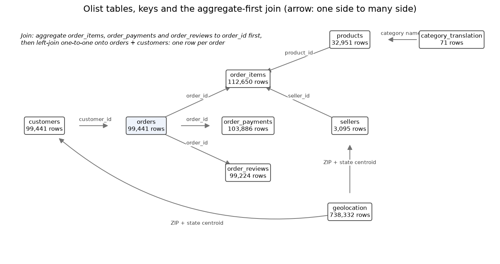

# Review pack: s02_data/common, round 2

| Field | Value |
| --- | --- |
| Run ID | `20261019T072845Z` |
| Base commit | `123cf32ca5ec6ff821eca5f8af4ba4d615157cec` plus uncommitted changes (committed at acceptance) |
| Outputs | FRESH |
| Coverage | 13 implemented, 0 deviation, 0 missing |
| Failed checks | 0 |
| Ready for acceptance | yes |

## Coverage

| ID | Solution step | Coverage | Checks | Changed since last round | Evidence |
| --- | --- | --- | --- | --- | --- |
| [2.1](#card-2-1) | Load | IMPLEMENTED | — | no | [data_hashes.json](../../outputs/data_hashes.json) |
| [2.2](#card-2-2) | Clean | IMPLEMENTED | — | no | [audit.json](../../outputs/audit.json) |
| [2.3](#card-2-3) | Geography | IMPLEMENTED | PASS | no | [zip_centroids.csv](../../outputs/zip_centroids.csv), [data_hashes.json](../../outputs/data_hashes.json), [audit.json](../../outputs/audit.json) |
| [2.4](#card-2-4) | Join | IMPLEMENTED | PASS | no | [records.csv.gz](../../outputs/records.csv.gz), [audit.json](../../outputs/audit.json) |
| [2.5](#card-2-5) | Predictors | IMPLEMENTED | PASS | no | [records.csv.gz](../../outputs/records.csv.gz) |
| [2.6](#card-2-6) | Targets | IMPLEMENTED | PASS | no | [records.csv.gz](../../outputs/records.csv.gz), [audit.json](../../outputs/audit.json) |
| [2.7](#card-2-7) | Leakage audit | IMPLEMENTED | PASS | no | [data_dictionary.csv](../../outputs/data_dictionary.csv), [audit.json](../../outputs/audit.json) |
| [2.8](#card-2-8) | Populations | IMPLEMENTED | PASS | no | [records.csv.gz](../../outputs/records.csv.gz), [exclusions.csv](../../outputs/exclusions.csv), [exclusion_counts.csv](../../outputs/exclusion_counts.csv) |
| [2.9](#card-2-9) | Outliers | IMPLEMENTED | PASS | no | [exclusions.csv](../../outputs/exclusions.csv), [exclusion_counts.csv](../../outputs/exclusion_counts.csv), [audit.json](../../outputs/audit.json) |
| [2.10](#card-2-10) | Missing installments | IMPLEMENTED | — | no | [exclusions.csv](../../outputs/exclusions.csv), [exclusion_counts.csv](../../outputs/exclusion_counts.csv) |
| [2.11](#card-2-11) | Missing payment | IMPLEMENTED | — | no | [exclusions.csv](../../outputs/exclusions.csv), [exclusion_counts.csv](../../outputs/exclusion_counts.csv) |
| [2.12](#card-2-12) | Data documentation | IMPLEMENTED | PASS | no | [data_dictionary.csv](../../outputs/data_dictionary.csv), [data_structure.png](../../outputs/figures/data_structure.png), [data_structure.csv](../../outputs/figures/data_structure.csv), [data_structure.json](../../outputs/figures/data_structure.json) |
| [2.13](#card-2-13) | Negative values | IMPLEMENTED | PASS | no | [exclusions.csv](../../outputs/exclusions.csv), [exclusion_counts.csv](../../outputs/exclusion_counts.csv) |

## Evidence cards

### 2.1 Load {#card-2-1}

Coverage: **IMPLEMENTED**; checks: **—**.

- **What was done:** Nine raw tables read with declared types; sha256 of every file and of the IBGE archive, derived geometry and manifest in data_hashes.json (12 files).
- **Claim type:** observation
- **Files:** [data_hashes.json](../../outputs/data_hashes.json)

### 2.2 Clean {#card-2-2}

Coverage: **IMPLEMENTED**; checks: **—**.

- **What was done:** Declared types per the Milestone 2 cleaning schema; ZIP prefixes read as strings; categorical domains checked (violations kept, listed in audit.json); geolocation exact duplicates dropped: 261,831 of 1,000,163 rows. No imputation.
- **Claim type:** observation
- **Files:** [audit.json](../../outputs/audit.json)

### 2.3 Geography {#card-2-3}

Coverage: **IMPLEMENTED**; checks: **PASS**.

- **What was done:** ZIP/state median centroids after the IBGE boundary filter: 738,303 of 738,332 geolocation rows accepted; 19,023 keys, by status {'resolved': 19015, 'median_outside_polygon': 4, 'no_surviving_coordinates': 4}.
- **Conclusion:** Archive and derived geometry match the pinned hashes.
- **Claim type:** observation
- **Check IBGE boundary hashes verified:** PASS archive e84c4d4ab199
- **Files:** [zip_centroids.csv](../../outputs/zip_centroids.csv), [data_hashes.json](../../outputs/data_hashes.json), [audit.json](../../outputs/audit.json)

### 2.4 Join {#card-2-4}

Coverage: **IMPLEMENTED**; checks: **PASS**.

- **What was done:** Items, payments and reviews aggregated to order_id first, then left-joined one-to-one (pandas validate); output rows 99,441 = orders 99,441.
- **Claim type:** observation
- **Check orders key order_id unique and non-null:** PASS 0 duplicates, 0 nulls
- **Check customers key customer_id unique and non-null:** PASS 0 duplicates, 0 nulls
- **Check products key product_id unique and non-null:** PASS 0 duplicates, 0 nulls
- **Check sellers key seller_id unique and non-null:** PASS 0 duplicates, 0 nulls
- **Check category_translation key product_category_name unique and non-null:** PASS 0 duplicates, 0 nulls
- **Check order_items key ['order_id', 'order_item_id'] unique and non-null:** PASS 0 duplicates, 0 nulls
- **Check order_payments key ['order_id', 'payment_sequential'] unique and non-null:** PASS 0 duplicates, 0 nulls
- **Check output rows = orders:** PASS 99441 rows, 99441 orders
- **Check every order has a customer:** PASS 0 without
- **Check order_id unique and non-null in records:** PASS
- **Files:** [records.csv.gz](../../outputs/records.csv.gz), [audit.json](../../outputs/audit.json)

### 2.5 Predictors {#card-2-5}

Coverage: **IMPLEMENTED**; checks: **PASS**.

- **What was done:** The 24 predictors of e5lib/contract.py built with the Milestone 2 formulas; calendar fields numeric; has_items, freight_ratio_missing and payment_missing not built.
- **Claim type:** observation
- **Check records hold exactly the 24 contract predictors:** PASS
- **Files:** [records.csv.gz](../../outputs/records.csv.gz)

### 2.6 Targets {#card-2-6}

Coverage: **IMPLEMENTED**; checks: **PASS**.

- **What was done:** lead_days for delivered orders with delivery after purchase; is_detractor from the minimum valid score; first-review label kept. Min and first labels agree on 98,615 of 98,673 reviewed orders.
- **Claim type:** observation
- **Check eligible orders have their target:** PASS
- **Files:** [records.csv.gz](../../outputs/records.csv.gz), [audit.json](../../outputs/audit.json)

### 2.7 Leakage audit {#card-2-7}

Coverage: **IMPLEMENTED**; checks: **PASS**.

- **What was done:** Every raw and records column tagged known / not known at checkout (data_dictionary.csv, audit.json); date-order violations logged: {'order_purchase_timestamp <= order_approved_at': 0, 'order_approved_at <= order_delivered_carrier_date': 1359, 'order_delivered_carrier_date <= order_delivered_customer_date': 23, 'order_estimated_delivery_date > order_purchase_timestamp': 0, 'first review answer > order_purchase_timestamp': 63, 'order_delivered_customer_date > order_purchase_timestamp (delivered orders)': 0}.
- **Reasoning:** Zero-item orders are excluded from both tasks (ZERO_ITEMS, step 2.8): items can be removed after checkout, so a zero item count would leak a later cancellation. For the same reason has_items is not in the contract (G-30, G-61).
- **Claim type:** observation
- **Check no predictor tagged not known at checkout:** PASS
- **Check data dictionary tags match the audit leakage tags:** PASS
- **Files:** [data_dictionary.csv](../../outputs/data_dictionary.csv), [audit.json](../../outputs/audit.json)

### 2.8 Populations {#card-2-8}

Coverage: **IMPLEMENTED**; checks: **PASS**.

- **What was done:** Population rules applied per task and written to exclusions.csv; counts in exclusion_counts.csv. Test cutoffs (80/20 on eligible orders after the population rules, before the outlier rule): {'regression': '2018-05-26 18:18:03', 'classification': '2018-05-25 18:44:28'}.
- **Reasoning:** Lead-time outliers are applied to the regression population only, because lead_days exists only for delivered orders; distance outliers apply to both tasks. Flagged for the team to confirm.
- **Claim type:** observation
- **Check every reason code has its pre-registered description:** PASS
- **Check no order silently dropped: every ineligible order has an exclusion row:** PASS
- **Check test cutoffs recorded in protocol.yaml:** PASS {'regression': '2018-05-26 18:18:03', 'classification': '2018-05-25 18:44:28'}
- **Files:** [records.csv.gz](../../outputs/records.csv.gz), [exclusions.csv](../../outputs/exclusions.csv), [exclusion_counts.csv](../../outputs/exclusion_counts.csv)

### 2.9 Outliers {#card-2-9}

Coverage: **IMPLEMENTED**; checks: **PASS**.

- **What was done:** Lead-time threshold max(100, mean + 12 SD) = 133.91 days from pre-cutoff regression orders (mean 13.51, SD 10.03); distance limit 4397.53 km. Removals on or after each cutoff: [{'task': 'regression', 'outlier_removals_on_or_after_cutoff': 1}, {'task': 'classification', 'outlier_removals_on_or_after_cutoff': 0}].
- **Claim type:** observation
- **Check outlier statistics use only pre-cutoff orders:** PASS latest purchase used 2018-05-26 18:16:57, cutoff 2018-05-26 18:18:03
- **Files:** [exclusions.csv](../../outputs/exclusions.csv), [exclusion_counts.csv](../../outputs/exclusion_counts.csv), [audit.json](../../outputs/audit.json)

### 2.10 Missing installments {#card-2-10}

Coverage: **IMPLEMENTED**; checks: **—**.

- **What was done:** Orders with no usable payment_installments_max removed from both tasks (MISSING_INSTALLMENTS).
- **Claim type:** observation
- **Files:** [exclusions.csv](../../outputs/exclusions.csv), [exclusion_counts.csv](../../outputs/exclusion_counts.csv)

### 2.11 Missing payment {#card-2-11}

Coverage: **IMPLEMENTED**; checks: **—**.

- **What was done:** Orders with no payment rows or only not_defined types removed from both tasks (NO_USABLE_PAYMENT).
- **Claim type:** observation
- **Files:** [exclusions.csv](../../outputs/exclusions.csv), [exclusion_counts.csv](../../outputs/exclusion_counts.csv)

### 2.12 Data documentation {#card-2-12}

Coverage: **IMPLEMENTED**; checks: **PASS**.

- **What was done:** data_dictionary.csv: 91 rows (every raw and records column, plus the three columns not in the contract); figures/data_structure.png with its link table.
- **Claim type:** observation
- **Check data dictionary: one row per raw and records column:** PASS
- **Check data dictionary tags match the audit leakage tags:** PASS

- **Files:** [data_dictionary.csv](../../outputs/data_dictionary.csv), [data_structure.png](../../outputs/figures/data_structure.png), [data_structure.csv](../../outputs/figures/data_structure.csv), [data_structure.json](../../outputs/figures/data_structure.json)

### 2.13 Negative values {#card-2-13}

Coverage: **IMPLEMENTED**; checks: **PASS**.

- **What was done:** Orders with a negative value in ['total_price', 'total_freight', 'total_weight_g', 'total_volume_cm3', 'distance_km_max'] removed from both tasks (NEGATIVE_VALUE); zero kept.
- **Claim type:** observation
- **Check every reason code has its pre-registered description:** PASS
- **Check eligible orders have no negative log1p candidate:** PASS
- **Files:** [exclusions.csv](../../outputs/exclusions.csv), [exclusion_counts.csv](../../outputs/exclusion_counts.csv)
