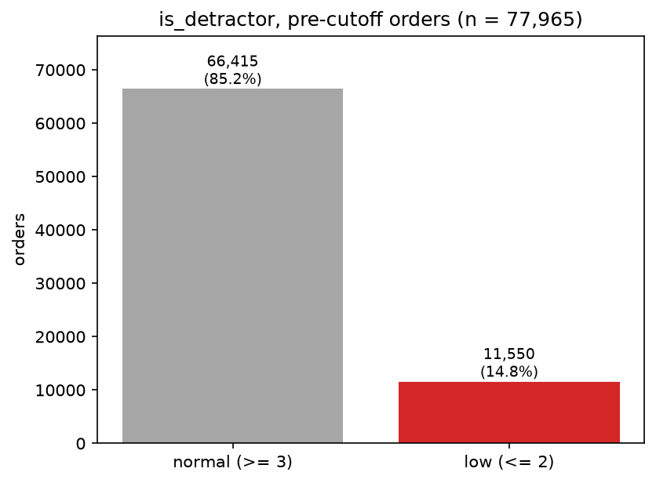
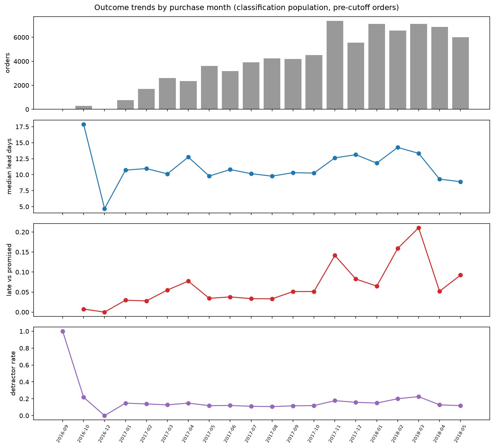
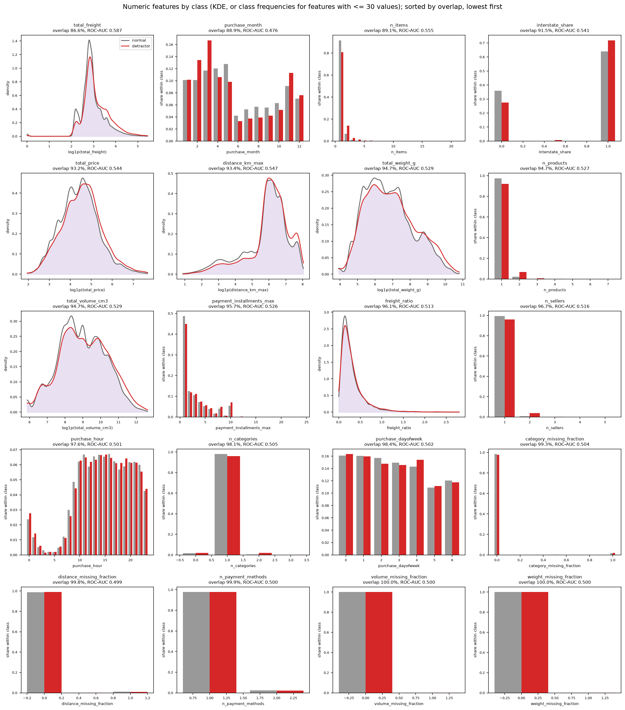
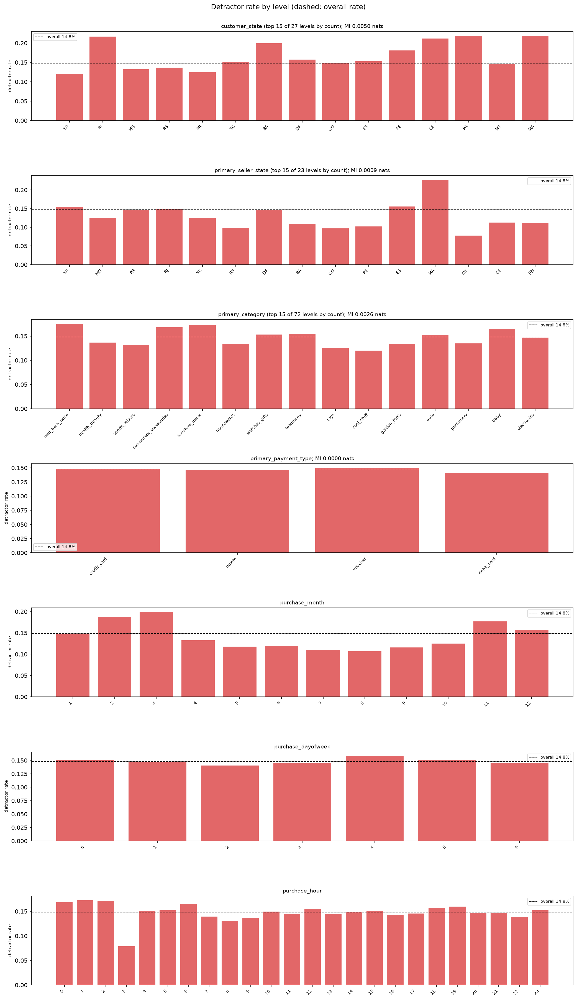
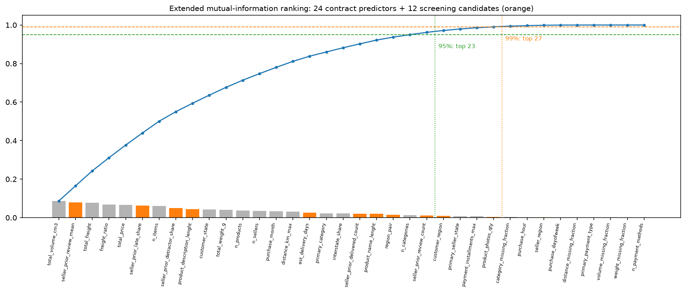
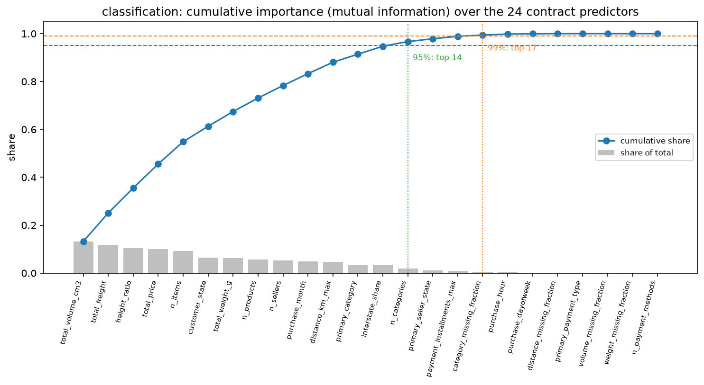
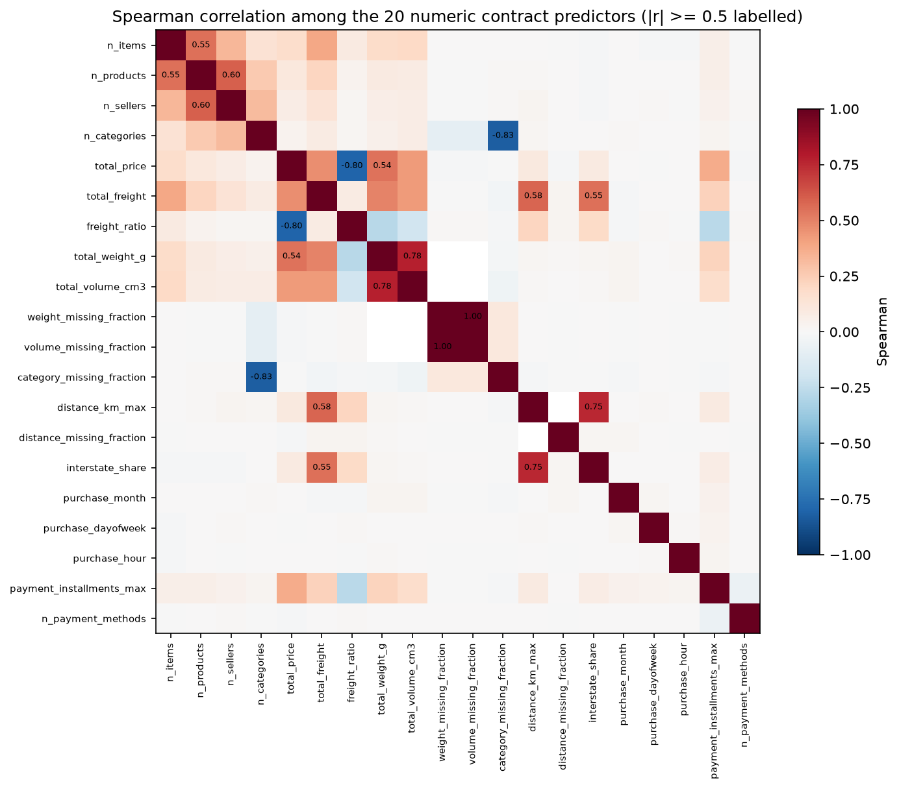

# EDA review pack: s03_eda/classification

Human gate before s04 (G-31). Every table and figure of this node is listed below; the team records its decisions in `spec/human_decisions.yaml` (section `s03_to_s04.classification`), logged in CHANGELOG.md. s04 does not run until both are recorded.

Rows: 77,965 eligible classification orders purchased before the test cutoff 2018-05-25 18:43:19 (latest purchase used 2018-05-25 18:35:11).

## Target: is_detractor (3.2)

| class | orders | share |
| --- | --- | --- |
| low review (score <= 2), is_detractor = 1 | 11550 | 0.1481 |
| normal review (score >= 3), is_detractor = 0 | 66415 | 0.8519 |
| total | 77965 | 1.0000 |



## Outcome trends (3.3)

| month | orders | orders_with_lead_time | median_lead_days | late_vs_promised_rate | orders_with_review | detractor_rate |
| --- | --- | --- | --- | --- | --- | --- |
| 2016-09 | 1 | 0 |  |  | 1 | 1.0000 |
| 2016-10 | 285 | 262 | 17.8825 | 0.0076 | 285 | 0.2175 |
| 2016-12 | 1 | 1 | 4.6930 | 0.0000 | 1 | 0.0000 |
| 2017-01 | 777 | 741 | 10.7145 | 0.0297 | 777 | 0.1480 |
| 2017-02 | 1708 | 1643 | 10.9498 | 0.0280 | 1708 | 0.1382 |
| 2017-03 | 2597 | 2526 | 10.1247 | 0.0550 | 2597 | 0.1275 |
| 2017-04 | 2360 | 2290 | 12.7430 | 0.0773 | 2360 | 0.1483 |
| 2017-05 | 3606 | 3517 | 9.7826 | 0.0344 | 3606 | 0.1179 |
| 2017-06 | 3181 | 3111 | 10.8020 | 0.0379 | 3181 | 0.1201 |
| 2017-07 | 3911 | 3842 | 10.1524 | 0.0336 | 3911 | 0.1102 |
| 2017-08 | 4241 | 4165 | 9.7698 | 0.0331 | 4241 | 0.1068 |
| 2017-09 | 4194 | 4118 | 10.3136 | 0.0512 | 4194 | 0.1159 |
| 2017-10 | 4510 | 4446 | 10.2492 | 0.0515 | 4510 | 0.1188 |
| 2017-11 | 7360 | 7237 | 12.6274 | 0.1415 | 7360 | 0.1773 |
| 2017-12 | 5561 | 5461 | 13.1226 | 0.0826 | 5561 | 0.1577 |
| 2018-01 | 7126 | 7013 | 11.8047 | 0.0649 | 7126 | 0.1485 |
| 2018-02 | 6573 | 6507 | 14.2617 | 0.1589 | 6573 | 0.2004 |
| 2018-03 | 7106 | 6948 | 13.3387 | 0.2106 | 7106 | 0.2250 |
| 2018-04 | 6859 | 6748 | 9.3033 | 0.0520 | 6859 | 0.1276 |
| 2018-05 | 6008 | 5934 | 8.9032 | 0.0923 | 6008 | 0.1183 |



## Numeric features vs is_detractor (3.6)

| feature | n | overlap_coefficient | overlap_method | roc_auc | mutual_information |
| --- | --- | --- | --- | --- | --- |
| total_freight | 77965 | 0.8659 | KDE (log1p scale) | 0.5871 | 0.0093 |
| purchase_month | 77965 | 0.8893 | discrete frequencies | 0.4758 | 0.0039 |
| n_items | 77965 | 0.8914 | discrete frequencies | 0.5548 | 0.0073 |
| interstate_share | 77965 | 0.9149 | discrete frequencies | 0.5408 | 0.0026 |
| total_price | 77965 | 0.9323 | KDE (log1p scale) | 0.5442 | 0.0079 |
| distance_km_max | 77056 | 0.9344 | KDE (log1p scale) | 0.5470 | 0.0037 |
| total_weight_g | 77949 | 0.9467 | KDE (log1p scale) | 0.5294 | 0.0048 |
| n_products | 77965 | 0.9468 | discrete frequencies | 0.5266 | 0.0044 |
| total_volume_cm3 | 77949 | 0.9474 | KDE (log1p scale) | 0.5292 | 0.0104 |
| payment_installments_max | 77965 | 0.9565 | discrete frequencies | 0.5257 | 0.0008 |
| freight_ratio | 77965 | 0.9611 | KDE | 0.5128 | 0.0082 |
| n_sellers | 77965 | 0.9672 | discrete frequencies | 0.5164 | 0.0041 |
| purchase_hour | 77965 | 0.9755 | discrete frequencies | 0.5008 | 0.0003 |
| n_categories | 77965 | 0.9806 | discrete frequencies | 0.5047 | 0.0015 |
| purchase_dayofweek | 77965 | 0.9835 | discrete frequencies | 0.5018 | 0.0001 |
| category_missing_fraction | 77965 | 0.9929 | discrete frequencies | 0.5035 | 0.0004 |
| distance_missing_fraction | 77965 | 0.9980 | discrete frequencies | 0.4991 | 0.0000 |
| n_payment_methods | 77965 | 0.9994 | discrete frequencies | 0.4997 | 0.0000 |
| volume_missing_fraction | 77965 | 0.9999 | discrete frequencies | 0.5000 | 0.0000 |
| weight_missing_fraction | 77965 | 0.9999 | discrete frequencies | 0.5000 | 0.0000 |



## Categorical features vs is_detractor (3.7)

| feature | mutual_information |
| --- | --- |
| customer_state | 0.0050 |
| primary_category | 0.0026 |
| primary_payment_type | 0.0000 |
| primary_seller_state | 0.0009 |

Per-level detractor rates: categorical_feature_target_is_detractor.csv.



## Missingness and outliers (3.8)

| feature | type | missing_share | share_outside_1_5_iqr | share_outside_3_iqr | vif | vif_note |
| --- | --- | --- | --- | --- | --- | --- |
| n_items | numeric | 0.0000 | 0.1001 | 0.1001 | 1.6499 |  |
| n_products | numeric | 0.0000 | 0.0327 | 0.0327 | 1.7994 |  |
| n_sellers | numeric | 0.0000 | 0.0120 | 0.0120 | 1.8523 |  |
| n_categories | numeric | 0.0000 | 0.0233 | 0.0233 | 4.9226 |  |
| total_price | numeric | 0.0000 | 0.0799 | 0.0409 | 1.4760 |  |
| total_freight | numeric | 0.0000 | 0.0969 | 0.0489 | 3.3271 |  |
| freight_ratio | numeric | 0.0000 | 0.0683 | 0.0229 | 1.2596 |  |
| total_weight_g | numeric | 0.0002 | 0.1409 | 0.0828 | 3.5012 |  |
| total_volume_cm3 | numeric | 0.0002 | 0.0979 | 0.0435 | 3.4254 |  |
| weight_missing_fraction | numeric | 0.0000 | 0.0002 | 0.0002 |  | constant on the complete rows |
| volume_missing_fraction | numeric | 0.0000 | 0.0002 | 0.0002 |  | constant on the complete rows |
| primary_category | categorical | 0.0000 |  |  |  |  |
| category_missing_fraction | numeric | 0.0000 | 0.0171 | 0.0171 | 4.3724 |  |
| customer_state | categorical | 0.0000 |  |  |  |  |
| primary_seller_state | categorical | 0.0000 |  |  |  |  |
| distance_km_max | numeric | 0.0117 | 0.0801 | 0.0069 | 1.6819 |  |
| distance_missing_fraction | numeric | 0.0000 | 0.0117 | 0.0117 |  | constant on the complete rows |
| interstate_share | numeric | 0.0000 | 0.0000 | 0.0000 | 1.4980 |  |
| purchase_month | numeric | 0.0000 | 0.0000 | 0.0000 | 1.0031 |  |
| purchase_dayofweek | numeric | 0.0000 | 0.0000 | 0.0000 | 1.0021 |  |
| purchase_hour | numeric | 0.0000 | 0.0000 | 0.0000 | 1.0007 |  |
| primary_payment_type | categorical | 0.0000 |  |  |  |  |
| payment_installments_max | numeric | 0.0000 | 0.0665 | 0.0016 | 1.1543 |  |
| n_payment_methods | numeric | 0.0000 | 0.0232 | 0.0232 | 1.0023 |  |

## Skewness of the log1p candidates (3.8, for s04 4.2)

| feature | skewness | threshold | log1p |
| --- | --- | --- | --- |
| total_price | 10.0407 | 1.0000 | True |
| total_freight | 8.0875 | 1.0000 | True |
| total_weight_g | 6.5865 | 1.0000 | True |
| total_volume_cm3 | 7.4701 | 1.0000 | True |
| distance_km_max | 1.6401 | 1.0000 | True |

## Candidate screen (3.10-3.13, G-68, G-69; not predictors unless adopted)

| card | feature | kind | n | missing_share | overlap_coefficient | roc_auc | mutual_information | rank_in_extended | inside_95_cut | inside_99_cut | skewness | vif_in_extended_set |
| --- | --- | --- | --- | --- | --- | --- | --- | --- | --- | --- | --- | --- |
| 3.10 | product_photos_qty | numeric | 76668 | 0.0166 | 0.9628 | 0.4796 | 0.0006 | 27 | False | True | 1.8944 | 1.0450 |
| 3.10 | product_description_lenght | numeric | 76668 | 0.0166 | 0.9776 | 0.4921 | 0.0052 | 9 | True | True | 2.0435 | 1.0910 |
| 3.10 | product_name_lenght | numeric | 76668 | 0.0166 | 0.9718 | 0.5038 | 0.0023 | 20 | True | True | -0.8820 | 1.0588 |
| 3.11 | est_delivery_days | numeric | 77965 | 0.0000 | 0.9496 | 0.5386 | 0.0032 | 16 | True | True | 1.3482 | 1.7261 |
| 3.12 | customer_region | categorical | 77965 | 0.0000 | 0.9544 |  | 0.0012 | 24 | False | True |  |  |
| 3.12 | seller_region | categorical | 77965 | 0.0000 | 0.9790 |  | 0.0002 | 30 | False | False |  |  |
| 3.12 | region_pair | categorical | 77965 | 0.0000 | 0.9498 |  | 0.0018 | 21 | True | True |  |  |
| 3.13 | seller_prior_review_mean | numeric | 72856 | 0.0655 | 0.9053 | 0.4409 | 0.0094 | 2 | True | True | -1.8627 | 5.1156 |
| 3.13 | seller_prior_review_count | numeric | 77965 | 0.0000 | 0.9622 | 0.5066 | 0.0014 | 23 | True | True | 2.6657 | 1442.8551 |
| 3.13 | seller_prior_detractor_share | numeric | 72856 | 0.0655 | 0.9047 | 0.5566 | 0.0059 | 8 | True | True | 3.0746 | 5.0685 |
| 3.13 | seller_prior_delivered_count | numeric | 77965 | 0.0000 | 0.9622 | 0.5058 | 0.0024 | 19 | True | True | 2.6084 | 1443.9248 |
| 3.13 | seller_prior_late_share | numeric | 73349 | 0.0592 | 0.9000 | 0.5360 | 0.0075 | 6 | True | True | 5.7008 | 1.2044 |

Extended cut points (24 + 12): {'0.95': 23, '0.99': 27}. Collinear groups involving a candidate: ['seller_prior_review_count', 'seller_prior_delivered_count']. Record adopted candidates under `adopted_candidates` in human_decisions.yaml.



## Importance ranking (3.8)

Measure: mutual information. All 24 contract predictors.

| rank | feature | type | method | value | share | cumulative_share |
| --- | --- | --- | --- | --- | --- | --- |
| 1 | total_volume_cm3 | numeric | mutual_info_classif, continuous (k-NN, k=3) | 0.0104 | 0.1323 | 0.1323 |
| 2 | total_freight | numeric | mutual_info_classif, continuous (k-NN, k=3) | 0.0093 | 0.1187 | 0.2510 |
| 3 | freight_ratio | numeric | mutual_info_classif, continuous (k-NN, k=3) | 0.0082 | 0.1044 | 0.3554 |
| 4 | total_price | numeric | mutual_info_classif, continuous (k-NN, k=3) | 0.0079 | 0.1003 | 0.4556 |
| 5 | n_items | numeric | mutual_info_classif, discrete (contingency) | 0.0073 | 0.0931 | 0.5487 |
| 6 | customer_state | categorical | mutual_info_classif, discrete (contingency) | 0.0050 | 0.0642 | 0.6129 |
| 7 | total_weight_g | numeric | mutual_info_classif, continuous (k-NN, k=3) | 0.0048 | 0.0617 | 0.6746 |
| 8 | n_products | numeric | mutual_info_classif, discrete (contingency) | 0.0044 | 0.0565 | 0.7311 |
| 9 | n_sellers | numeric | mutual_info_classif, discrete (contingency) | 0.0041 | 0.0521 | 0.7832 |
| 10 | purchase_month | numeric | mutual_info_classif, discrete (contingency) | 0.0039 | 0.0497 | 0.8329 |
| 11 | distance_km_max | numeric | mutual_info_classif, continuous (k-NN, k=3) | 0.0037 | 0.0477 | 0.8805 |
| 12 | primary_category | categorical | mutual_info_classif, discrete (contingency) | 0.0026 | 0.0335 | 0.9141 |
| 13 | interstate_share | numeric | mutual_info_classif, discrete (contingency) | 0.0026 | 0.0333 | 0.9474 |
| 14 | n_categories | numeric | mutual_info_classif, discrete (contingency) | 0.0015 | 0.0196 | 0.9670 |
| 15 | primary_seller_state | categorical | mutual_info_classif, discrete (contingency) | 0.0009 | 0.0116 | 0.9786 |
| 16 | payment_installments_max | numeric | mutual_info_classif, discrete (contingency) | 0.0008 | 0.0102 | 0.9887 |
| 17 | category_missing_fraction | numeric | mutual_info_classif, discrete (contingency) | 0.0004 | 0.0054 | 0.9941 |
| 18 | purchase_hour | numeric | mutual_info_classif, discrete (contingency) | 0.0003 | 0.0040 | 0.9981 |
| 19 | purchase_dayofweek | numeric | mutual_info_classif, discrete (contingency) | 0.0001 | 0.0013 | 0.9995 |
| 20 | distance_missing_fraction | numeric | mutual_info_classif, discrete (contingency) | 0.0000 | 0.0004 | 0.9999 |
| 21 | primary_payment_type | categorical | mutual_info_classif, discrete (contingency) | 0.0000 | 0.0001 | 1.0000 |
| 22 | volume_missing_fraction | numeric | mutual_info_classif, discrete (contingency) | 0.0000 | 0.0000 | 1.0000 |
| 23 | weight_missing_fraction | numeric | mutual_info_classif, discrete (contingency) | 0.0000 | 0.0000 | 1.0000 |
| 24 | n_payment_methods | numeric | mutual_info_classif, discrete (contingency) | 0.0000 | 0.0000 | 1.0000 |



| Threshold option | Features kept (top k) | Features kept |
| --- | --- | --- |
| 95% | 14 | total_volume_cm3, total_freight, freight_ratio, total_price, n_items, customer_state, total_weight_g, n_products, n_sellers, purchase_month, distance_km_max, primary_category, interstate_share, n_categories |
| 99% | 17 | total_volume_cm3, total_freight, freight_ratio, total_price, n_items, customer_state, total_weight_g, n_products, n_sellers, purchase_month, distance_km_max, primary_category, interstate_share, n_categories, primary_seller_state, payment_installments_max, category_missing_fraction |

## Collinearity among raw numeric features (3.8)

Cut-offs from protocol.yaml: |correlation| > 0.9 (Pearson or Spearman) or VIF > 10; VIF on 77,040 complete rows (a column constant on those rows has no VIF). Nothing is dropped in s03.

Identical columns (dropped automatically in s04 4.3, no team decision needed): weight_missing_fraction = volume_missing_fraction.

No group needs a team decision: no pair of distinct columns above the correlation cut-off and no VIF above the VIF cut-off.

| feature_a | feature_b | pearson | spearman | identical |
| --- | --- | --- | --- | --- |
| weight_missing_fraction | volume_missing_fraction | 1.0000 | 1.0000 | True |



## Decisions for the team (record in spec/human_decisions.yaml)

```yaml
s03_to_s04:
  classification:
    cumulative_importance_threshold: 0.95   # or 0.99
    collinearity_drops:
    adopted_candidates: []   # any of ['product_photos_qty', 'product_description_lenght', 'product_name_lenght', 'est_delivery_days', 'customer_region', 'seller_region', 'region_pair', 'seller_prior_review_mean', 'seller_prior_review_count', 'seller_prior_detractor_share', 'seller_prior_delivered_count', 'seller_prior_late_share'] (G-68), with rationale
```
