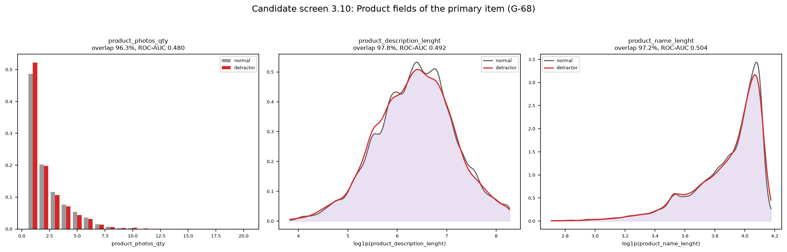
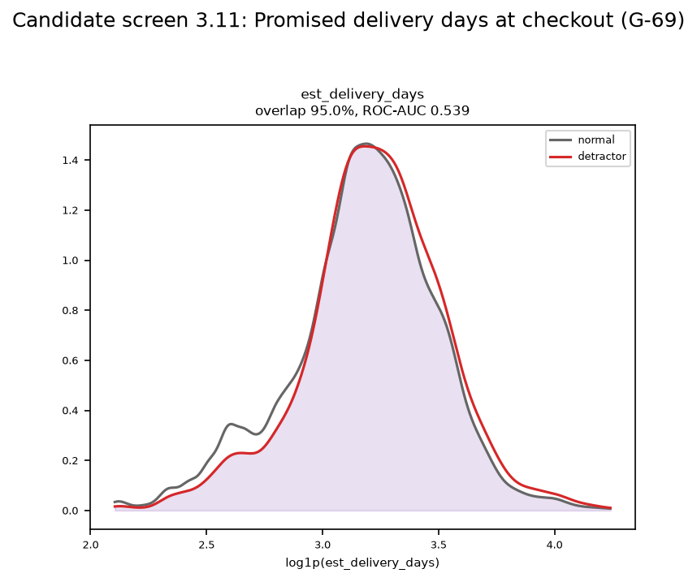
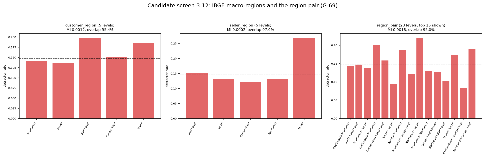
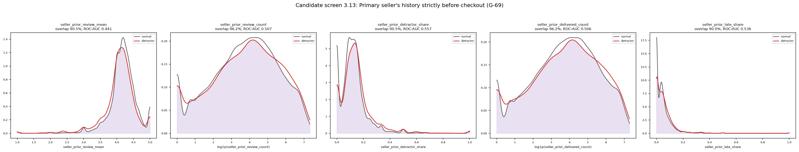

# Review pack: s03_eda/classification, round 4

| Field | Value |
| --- | --- |
| Run ID | `20261019T163353Z` |
| Base commit | `aca98ac99b1a7a21ae26076f070de91a73d6e7b1` |
| Outputs | FRESH |
| Coverage | 10 implemented, 0 deviation, 0 missing |
| Failed checks | 0 |
| Ready for acceptance | yes |

## Coverage

| ID | Solution step | Coverage | Checks | Changed since last round | Evidence |
| --- | --- | --- | --- | --- | --- |
| [3.2](#card-3-2) | Classification target | IMPLEMENTED | PASS | yes | [target_classification_is_detractor.csv](../../outputs/target_classification_is_detractor.csv), [target_is_detractor_bar.png](../../outputs/figures/target_is_detractor_bar.png), [target_is_detractor_bar.csv](../../outputs/figures/target_is_detractor_bar.csv), [target_is_detractor_bar.json](../../outputs/figures/target_is_detractor_bar.json), [eda_summary.json](../../outputs/eda_summary.json) |
| [3.3](#card-3-3) | Outcome trends | IMPLEMENTED | PASS | yes | [outcome_trends.csv](../../outputs/outcome_trends.csv), [outcome_trends.png](../../outputs/figures/outcome_trends.png), [outcome_trends.csv](../../outputs/figures/outcome_trends.csv), [outcome_trends.json](../../outputs/figures/outcome_trends.json), [eda_summary.json](../../outputs/eda_summary.json) |
| [3.6](#card-3-6) | Numeric features vs is_detractor | IMPLEMENTED | PASS | yes | [numeric_feature_target_is_detractor.csv](../../outputs/numeric_feature_target_is_detractor.csv), [numeric_vs_is_detractor.png](../../outputs/figures/numeric_vs_is_detractor.png), [numeric_vs_is_detractor.csv](../../outputs/figures/numeric_vs_is_detractor.csv), [numeric_vs_is_detractor.json](../../outputs/figures/numeric_vs_is_detractor.json) |
| [3.7](#card-3-7) | Categorical features vs is_detractor | IMPLEMENTED | PASS | yes | [categorical_feature_target_is_detractor.csv](../../outputs/categorical_feature_target_is_detractor.csv), [categorical_vs_is_detractor.png](../../outputs/figures/categorical_vs_is_detractor.png), [categorical_vs_is_detractor.csv](../../outputs/figures/categorical_vs_is_detractor.csv), [categorical_vs_is_detractor.json](../../outputs/figures/categorical_vs_is_detractor.json) |
| [3.8](#card-3-8) | Importance ranking | IMPLEMENTED | PASS | yes | [feature_quality.csv](../../outputs/feature_quality.csv), [collinear_pairs.csv](../../outputs/collinear_pairs.csv), [numeric_correlations.csv](../../outputs/numeric_correlations.csv), [numeric_correlation_heatmap.png](../../outputs/figures/numeric_correlation_heatmap.png), [numeric_correlation_heatmap.csv](../../outputs/figures/numeric_correlation_heatmap.csv), [numeric_correlation_heatmap.json](../../outputs/figures/numeric_correlation_heatmap.json), [importance_ranking.csv](../../outputs/importance_ranking.csv), [cumulative_importance.png](../../outputs/figures/cumulative_importance.png), [cumulative_importance.csv](../../outputs/figures/cumulative_importance.csv), [cumulative_importance.json](../../outputs/figures/cumulative_importance.json), [candidate_rationale.csv](../../outputs/candidate_rationale.csv), [eda_summary.json](../../outputs/eda_summary.json), [decision.json](../../outputs/decision.json) |
| [3.9](#card-3-9) | Human gate (review pack for s04 decisions) | IMPLEMENTED | PASS | yes | [cumulative_importance.png](../../outputs/figures/cumulative_importance.png), [cumulative_importance.csv](../../outputs/figures/cumulative_importance.csv), [cumulative_importance.json](../../outputs/figures/cumulative_importance.json), [eda_review_pack.md](../../outputs/eda_review_pack.md) |
| [3.10](#card-3-10) | Candidate screen: product fields and extended ranking (G-68) | IMPLEMENTED | PASS | yes | [candidate_screen.png](../../outputs/figures/candidate_screen.png), [candidate_screen.csv](../../outputs/figures/candidate_screen.csv), [candidate_screen.json](../../outputs/figures/candidate_screen.json), [candidate_screen_3_10.csv](../../outputs/candidate_screen_3_10.csv), [candidate_ranking_extended.csv](../../outputs/candidate_ranking_extended.csv), [candidate_collinear_pairs.csv](../../outputs/candidate_collinear_pairs.csv), [candidate_ranking_extended.png](../../outputs/figures/candidate_ranking_extended.png), [candidate_ranking_extended.csv](../../outputs/figures/candidate_ranking_extended.csv), [candidate_ranking_extended.json](../../outputs/figures/candidate_ranking_extended.json), [eda_summary.json](../../outputs/eda_summary.json) |
| [3.11](#card-3-11) | Candidate screen: promised delivery days (G-69) | IMPLEMENTED | PASS | yes | [candidate_screen_promise.png](../../outputs/figures/candidate_screen_promise.png), [candidate_screen_promise.csv](../../outputs/figures/candidate_screen_promise.csv), [candidate_screen_promise.json](../../outputs/figures/candidate_screen_promise.json), [candidate_screen_3_11.csv](../../outputs/candidate_screen_3_11.csv), [eda_summary.json](../../outputs/eda_summary.json) |
| [3.12](#card-3-12) | Candidate screen: regions (G-69) | IMPLEMENTED | PASS | yes | [candidate_screen_region.png](../../outputs/figures/candidate_screen_region.png), [candidate_screen_region.csv](../../outputs/figures/candidate_screen_region.csv), [candidate_screen_region.json](../../outputs/figures/candidate_screen_region.json), [candidate_screen_3_12.csv](../../outputs/candidate_screen_3_12.csv), [candidate_screen_levels.csv](../../outputs/candidate_screen_levels.csv), [eda_summary.json](../../outputs/eda_summary.json) |
| [3.13](#card-3-13) | Candidate screen: seller history at checkout (G-69) | IMPLEMENTED | PASS | yes | [candidate_screen_seller_history.png](../../outputs/figures/candidate_screen_seller_history.png), [candidate_screen_seller_history.csv](../../outputs/figures/candidate_screen_seller_history.csv), [candidate_screen_seller_history.json](../../outputs/figures/candidate_screen_seller_history.json), [candidate_screen_3_13.csv](../../outputs/candidate_screen_3_13.csv), [candidate_collinear_pairs.csv](../../outputs/candidate_collinear_pairs.csv), [eda_summary.json](../../outputs/eda_summary.json) |

## Evidence cards

### 3.2 Classification target {#card-3-2}

Coverage: **IMPLEMENTED**; checks: **PASS**.

- **What was done:** 77,965 pre-cutoff orders: 11,550 low reviews (score <= 2, 14.81%) and 66,415 normal reviews (score >= 3, 85.19%).
- **Conclusion:** Imbalanced target: average precision is read against the prevalence baseline.
- **Claim type:** observation
- **Check no order on or after the test cutoff loaded:** PASS latest purchase 2018-05-25 18:35:11, cutoff 2018-05-25 18:43:19

- **Files:** [target_classification_is_detractor.csv](../../outputs/target_classification_is_detractor.csv), [target_is_detractor_bar.png](../../outputs/figures/target_is_detractor_bar.png), [target_is_detractor_bar.csv](../../outputs/figures/target_is_detractor_bar.csv), [target_is_detractor_bar.json](../../outputs/figures/target_is_detractor_bar.json), [eda_summary.json](../../outputs/eda_summary.json)

### 3.3 Outcome trends {#card-3-3}

Coverage: **IMPLEMENTED**; checks: **PASS**.

- **What was done:** 20 purchase months; over the 18 months with at least 100 orders: detractor rate 10.7% to 22.5%, late-vs-promised rate 0.8% to 21.1%, median lead time 8.9 to 17.9 days; every month is in the table with its counts.
- **Reasoning:** Late is delivery after order_estimated_delivery_date, used here only as a description (G-35).
- **Claim type:** observation
- **Check no order on or after the test cutoff loaded:** PASS latest purchase 2018-05-25 18:35:11, cutoff 2018-05-25 18:43:19
- **Check outcome trends show outcomes, not volume only:** PASS

- **Files:** [outcome_trends.csv](../../outputs/outcome_trends.csv), [outcome_trends.png](../../outputs/figures/outcome_trends.png), [outcome_trends.csv](../../outputs/figures/outcome_trends.csv), [outcome_trends.json](../../outputs/figures/outcome_trends.json), [eda_summary.json](../../outputs/eda_summary.json)

### 3.6 Numeric features vs is_detractor {#card-3-6}

Coverage: **IMPLEMENTED**; checks: **PASS**.

- **What was done:** 20 numeric predictors: class-conditional distributions with the overlap coefficient (KDE for continuous features, class frequencies for features with at most 30 values), per-feature ROC-AUC and mutual information on the same rows; lowest overlap: total_freight (86.6%, ROC-AUC 0.587).
- **Reasoning:** A KDE smears an integer count into values that cannot occur, so features with few values use the class frequencies; the five log1p candidates use the KDE on the log1p scale (the coefficient does not change under a monotone transform). Flagged for the team (decision 2).
- **Claim type:** observation
- **Check all 24 contract predictors diagnosed against is_detractor:** PASS

- **Files:** [numeric_feature_target_is_detractor.csv](../../outputs/numeric_feature_target_is_detractor.csv), [numeric_vs_is_detractor.png](../../outputs/figures/numeric_vs_is_detractor.png), [numeric_vs_is_detractor.csv](../../outputs/figures/numeric_vs_is_detractor.csv), [numeric_vs_is_detractor.json](../../outputs/figures/numeric_vs_is_detractor.json)

### 3.7 Categorical features vs is_detractor {#card-3-7}

Coverage: **IMPLEMENTED**; checks: **PASS**.

- **What was done:** Four categorical predictors: mutual_info_classif (discrete, seed 42) and per-level detractor rates; calendar fields shown per level for the plots only. MI: customer_state 0.0050, primary_seller_state 0.0009, primary_category 0.0026, primary_payment_type 0.0000 nats.
- **Claim type:** observation
- **Check all 24 contract predictors diagnosed against is_detractor:** PASS

- **Files:** [categorical_feature_target_is_detractor.csv](../../outputs/categorical_feature_target_is_detractor.csv), [categorical_vs_is_detractor.png](../../outputs/figures/categorical_vs_is_detractor.png), [categorical_vs_is_detractor.csv](../../outputs/figures/categorical_vs_is_detractor.csv), [categorical_vs_is_detractor.json](../../outputs/figures/categorical_vs_is_detractor.json)

### 3.8 Importance ranking {#card-3-8}

Coverage: **IMPLEMENTED**; checks: **PASS**.

- **What was done:** Ranking over the 24 contract predictors by mutual information (discrete estimator for categorical features and features with at most 30 values, k-NN estimator for the rest): top 5 ['total_volume_cm3', 'total_freight', 'freight_ratio', 'total_price', 'n_items']; cut points {'0.95': 14, '0.99': 17}. Missingness, IQR outliers, Pearson/Spearman matrix and VIF on 77,040 complete rows; flagged groups: []; identical columns: [('weight_missing_fraction', 'volume_missing_fraction')].
- **Claim type:** observation
- **Check no order on or after the test cutoff loaded:** PASS latest purchase 2018-05-25 18:35:11, cutoff 2018-05-25 18:43:19
- **Check importance_ranking has the 24 contract predictors and ends at cumulative share 1.0:** PASS 24 rows
- **Check ranking measure is the pre-registered one:** PASS

- **Files:** [feature_quality.csv](../../outputs/feature_quality.csv), [collinear_pairs.csv](../../outputs/collinear_pairs.csv), [numeric_correlations.csv](../../outputs/numeric_correlations.csv), [numeric_correlation_heatmap.png](../../outputs/figures/numeric_correlation_heatmap.png), [numeric_correlation_heatmap.csv](../../outputs/figures/numeric_correlation_heatmap.csv), [numeric_correlation_heatmap.json](../../outputs/figures/numeric_correlation_heatmap.json), [importance_ranking.csv](../../outputs/importance_ranking.csv), [cumulative_importance.png](../../outputs/figures/cumulative_importance.png), [cumulative_importance.csv](../../outputs/figures/cumulative_importance.csv), [cumulative_importance.json](../../outputs/figures/cumulative_importance.json), [candidate_rationale.csv](../../outputs/candidate_rationale.csv), [eda_summary.json](../../outputs/eda_summary.json), [decision.json](../../outputs/decision.json)

### 3.9 Human gate (review pack for s04 decisions) {#card-3-9}

Coverage: **IMPLEMENTED**; checks: **PASS**.

- **What was done:** eda_review_pack.md lists every table and figure above, the ranking with both cut points, the flagged collinear groups and the YAML block the team fills in spec/human_decisions.yaml.
- **Conclusion:** Stop: s04 waits for the team's threshold and collinearity decisions (G-31).
- **Claim type:** observation
- **Check review pack lists both cut points and every flagged group:** PASS

- **Files:** [cumulative_importance.png](../../outputs/figures/cumulative_importance.png), [cumulative_importance.csv](../../outputs/figures/cumulative_importance.csv), [cumulative_importance.json](../../outputs/figures/cumulative_importance.json), [eda_review_pack.md](../../outputs/eda_review_pack.md)

### 3.10 Candidate screen: product fields and extended ranking (G-68) {#card-3-10}

Coverage: **IMPLEMENTED**; checks: **PASS**.

- **What was done:** Screening columns (not predictors) diagnosed against is_detractor with the 3.6 measures; numeric ones also with skewness, correlation with the 20 numeric predictors and VIF in the extended numeric set. Product fields (primary item): product_photos_qty: rank 27, MI 0.0006, ROC-AUC 0.480, overlap 96.3%; product_description_lenght: rank 9, MI 0.0052, ROC-AUC 0.492, overlap 97.8%; product_name_lenght: rank 20, MI 0.0023, ROC-AUC 0.504, overlap 97.2%. Extended ranking over 24 + 12 candidates; cut points {'0.95': 23, '0.99': 27} (official 3.8 ranking unchanged at 24).
- **Reasoning:** The extended ranking shows where each candidate would enter; s04 recomputes the cumulative share over the agreed pool (24 + adopted candidates). Screening on pre-cutoff orders and then choosing is a post-hoc addition; the report says so.
- **Conclusion:** Team decision at the gate: adopt or drop each candidate (human_decisions.yaml).
- **Claim type:** observation
- **Check candidate screen 3.10 covers every product candidate:** PASS 3 candidates
- **Check extended ranking holds the 24 predictors and every candidate, ends at 1.0; official ranking unchanged at 24:** PASS 36 rows

- **Files:** [candidate_screen.png](../../outputs/figures/candidate_screen.png), [candidate_screen.csv](../../outputs/figures/candidate_screen.csv), [candidate_screen.json](../../outputs/figures/candidate_screen.json), [candidate_screen_3_10.csv](../../outputs/candidate_screen_3_10.csv), [candidate_ranking_extended.csv](../../outputs/candidate_ranking_extended.csv), [candidate_collinear_pairs.csv](../../outputs/candidate_collinear_pairs.csv), [candidate_ranking_extended.png](../../outputs/figures/candidate_ranking_extended.png), [candidate_ranking_extended.csv](../../outputs/figures/candidate_ranking_extended.csv), [candidate_ranking_extended.json](../../outputs/figures/candidate_ranking_extended.json), [eda_summary.json](../../outputs/eda_summary.json)

### 3.11 Candidate screen: promised delivery days (G-69) {#card-3-11}

Coverage: **IMPLEMENTED**; checks: **PASS**.

- **What was done:** Screening columns (not predictors) diagnosed against is_detractor with the 3.6 measures; numeric ones also with skewness, correlation with the 20 numeric predictors and VIF in the extended numeric set. Promised delivery days: est_delivery_days: rank 16, MI 0.0032, ROC-AUC 0.539, overlap 95.0%.
- **Reasoning:** G-35 is reopened for this screen only. Olist's own promise is measured here; in production the promise would come from the task 1 prediction, so if adopted the classifier trains on out-of-fold task 1 predictions, which makes classification s06 depend on regression s06.
- **Claim type:** observation
- **Check candidate screen 3.11 covers every promise candidate:** PASS 1 candidates

- **Files:** [candidate_screen_promise.png](../../outputs/figures/candidate_screen_promise.png), [candidate_screen_promise.csv](../../outputs/figures/candidate_screen_promise.csv), [candidate_screen_promise.json](../../outputs/figures/candidate_screen_promise.json), [candidate_screen_3_11.csv](../../outputs/candidate_screen_3_11.csv), [eda_summary.json](../../outputs/eda_summary.json)

### 3.12 Candidate screen: regions (G-69) {#card-3-12}

Coverage: **IMPLEMENTED**; checks: **PASS**.

- **What was done:** Screening columns (not predictors) diagnosed against is_detractor with the 3.6 measures; numeric ones also with skewness, correlation with the 20 numeric predictors and VIF in the extended numeric set. Regions (IBGE macro-regions; pair = customer>seller): customer_region: rank 24, MI 0.0012, overlap 95.4%; seller_region: rank 30, MI 0.0002, overlap 97.9%; region_pair: rank 21, MI 0.0018, overlap 95.0%. Per-level detractor rates in candidate_screen_levels.csv.
- **Reasoning:** A region has 5 levels instead of 27 states, so each level holds more orders; the pair captures logistics corridors. Mutual information with many levels is biased upward, so compare the region and state values with that in mind.
- **Claim type:** observation
- **Check candidate screen 3.12 covers every region candidate:** PASS 3 candidates

- **Files:** [candidate_screen_region.png](../../outputs/figures/candidate_screen_region.png), [candidate_screen_region.csv](../../outputs/figures/candidate_screen_region.csv), [candidate_screen_region.json](../../outputs/figures/candidate_screen_region.json), [candidate_screen_3_12.csv](../../outputs/candidate_screen_3_12.csv), [candidate_screen_levels.csv](../../outputs/candidate_screen_levels.csv), [eda_summary.json](../../outputs/eda_summary.json)

### 3.13 Candidate screen: seller history at checkout (G-69) {#card-3-13}

Coverage: **IMPLEMENTED**; checks: **PASS**.

- **What was done:** Screening columns (not predictors) diagnosed against is_detractor with the 3.6 measures; numeric ones also with skewness, correlation with the 20 numeric predictors and VIF in the extended numeric set. Seller history at checkout: seller_prior_review_mean: rank 2, MI 0.0094, ROC-AUC 0.441, overlap 90.5%; seller_prior_review_count: rank 23, MI 0.0014, ROC-AUC 0.507, overlap 96.2%; seller_prior_detractor_share: rank 8, MI 0.0059, ROC-AUC 0.557, overlap 90.5%; seller_prior_delivered_count: rank 19, MI 0.0024, ROC-AUC 0.506, overlap 96.2%; seller_prior_late_share: rank 6, MI 0.0075, ROC-AUC 0.536, overlap 90.0%.
- **Reasoning:** Only the primary seller's events strictly before the purchase second count (reviews at their answer time, deliveries at delivery time) and the order's own events never count; s02 checks this against a direct recomputation on 2,000 orders. Sellers without history are missing, with the counts at 0.
- **Claim type:** observation
- **Check candidate screen 3.13 covers every seller_history candidate:** PASS 5 candidates

- **Files:** [candidate_screen_seller_history.png](../../outputs/figures/candidate_screen_seller_history.png), [candidate_screen_seller_history.csv](../../outputs/figures/candidate_screen_seller_history.csv), [candidate_screen_seller_history.json](../../outputs/figures/candidate_screen_seller_history.json), [candidate_screen_3_13.csv](../../outputs/candidate_screen_3_13.csv), [candidate_collinear_pairs.csv](../../outputs/candidate_collinear_pairs.csv), [eda_summary.json](../../outputs/eda_summary.json)
