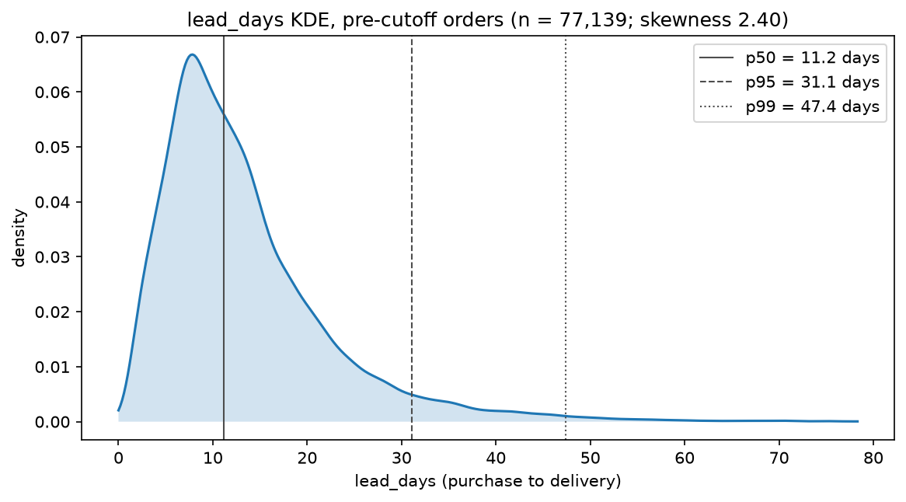
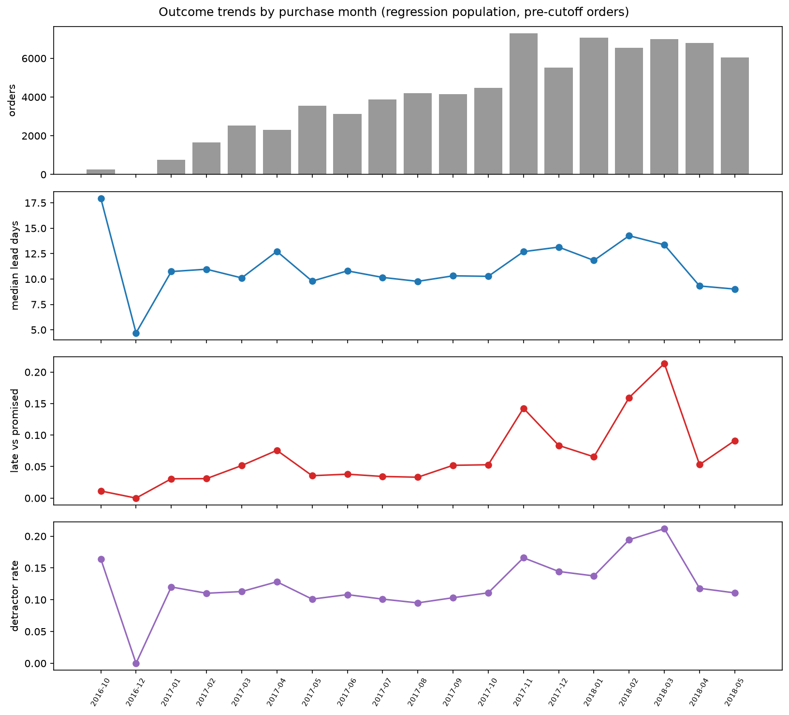
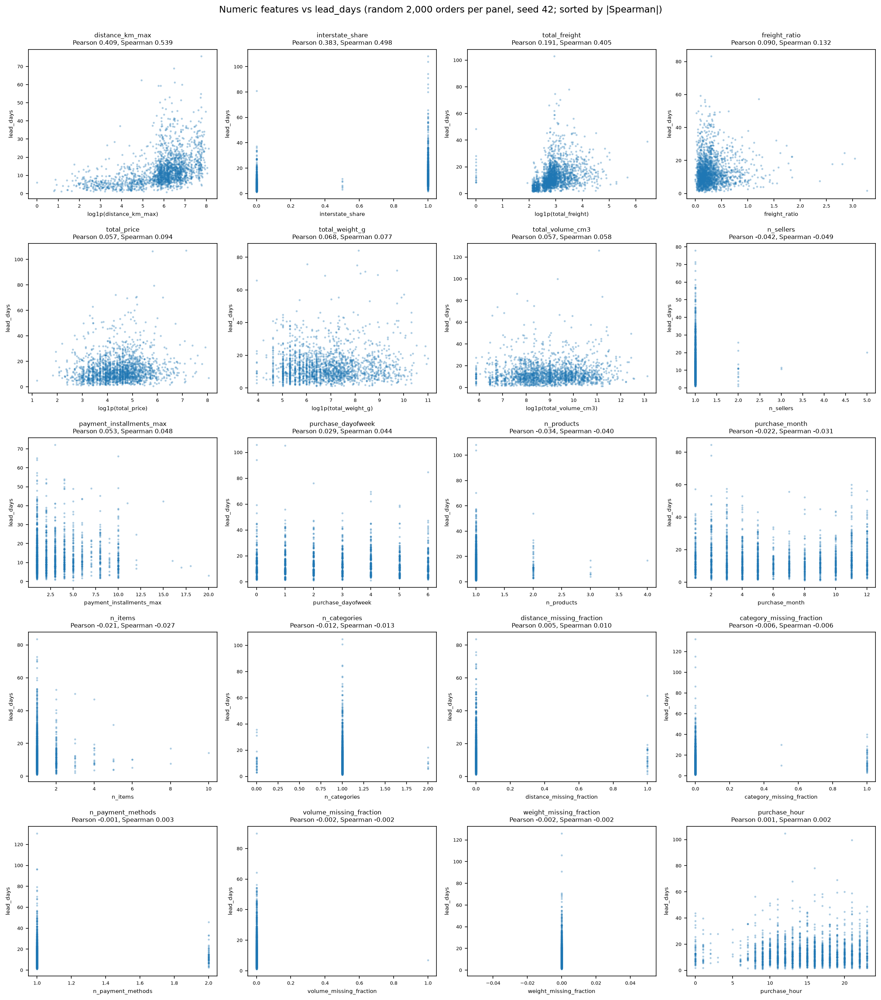
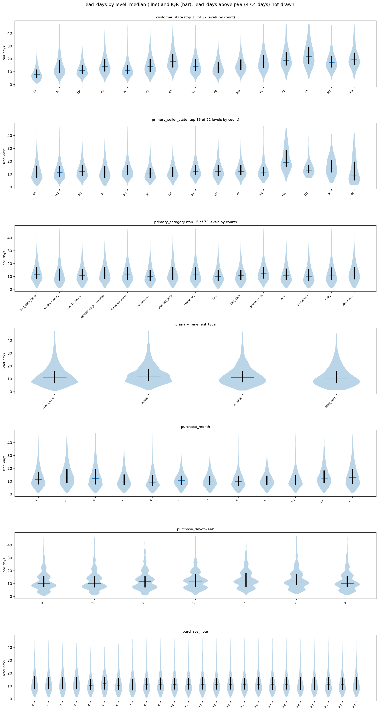
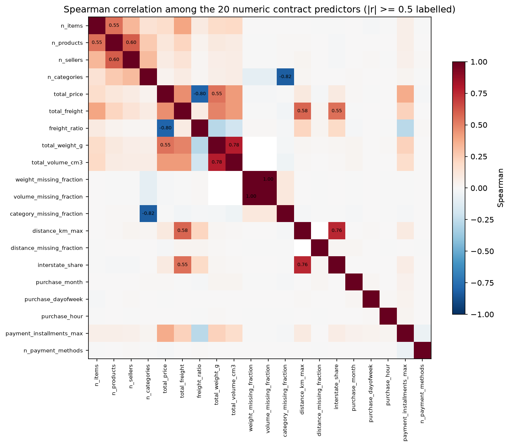
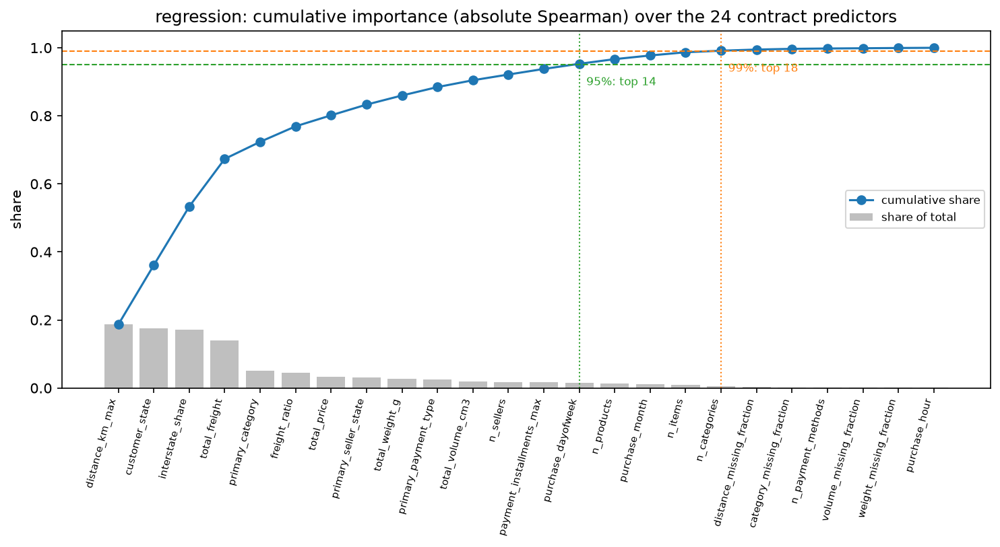

# Review pack: s03_eda/regression, round 2

| Field | Value |
| --- | --- |
| Run ID | `20261019T140119Z` |
| Base commit | `f4b7cbf6691d63496b56bcdcbc88f49ac34cf1a9` plus uncommitted changes (committed at acceptance) |
| Outputs | FRESH |
| Coverage | 6 implemented, 0 deviation, 0 missing |
| Failed checks | 0 |
| Ready for acceptance | yes |

## Coverage

| ID | Solution step | Coverage | Checks | Changed since last round | Evidence |
| --- | --- | --- | --- | --- | --- |
| [3.1](#card-3-1) | Regression target | IMPLEMENTED | PASS | no | [target_regression_lead_days.csv](../../outputs/target_regression_lead_days.csv), [target_lead_days_kde.png](../../outputs/figures/target_lead_days_kde.png), [target_lead_days_kde.csv](../../outputs/figures/target_lead_days_kde.csv), [target_lead_days_kde.json](../../outputs/figures/target_lead_days_kde.json), [eda_summary.json](../../outputs/eda_summary.json) |
| [3.3](#card-3-3) | Outcome trends | IMPLEMENTED | PASS | no | [outcome_trends.csv](../../outputs/outcome_trends.csv), [outcome_trends.png](../../outputs/figures/outcome_trends.png), [outcome_trends.csv](../../outputs/figures/outcome_trends.csv), [outcome_trends.json](../../outputs/figures/outcome_trends.json), [eda_summary.json](../../outputs/eda_summary.json) |
| [3.4](#card-3-4) | Numeric features vs lead_days | IMPLEMENTED | PASS | no | [numeric_feature_target_lead_days.csv](../../outputs/numeric_feature_target_lead_days.csv), [numeric_vs_lead_days.png](../../outputs/figures/numeric_vs_lead_days.png), [numeric_vs_lead_days.csv](../../outputs/figures/numeric_vs_lead_days.csv), [numeric_vs_lead_days.json](../../outputs/figures/numeric_vs_lead_days.json) |
| [3.5](#card-3-5) | Categorical features vs lead_days | IMPLEMENTED | PASS | no | [categorical_feature_target_lead_days.csv](../../outputs/categorical_feature_target_lead_days.csv), [categorical_vs_lead_days.png](../../outputs/figures/categorical_vs_lead_days.png), [categorical_vs_lead_days.csv](../../outputs/figures/categorical_vs_lead_days.csv), [categorical_vs_lead_days.json](../../outputs/figures/categorical_vs_lead_days.json) |
| [3.8](#card-3-8) | Importance ranking | IMPLEMENTED | PASS | no | [feature_quality.csv](../../outputs/feature_quality.csv), [collinear_pairs.csv](../../outputs/collinear_pairs.csv), [numeric_correlations.csv](../../outputs/numeric_correlations.csv), [numeric_correlation_heatmap.png](../../outputs/figures/numeric_correlation_heatmap.png), [numeric_correlation_heatmap.csv](../../outputs/figures/numeric_correlation_heatmap.csv), [numeric_correlation_heatmap.json](../../outputs/figures/numeric_correlation_heatmap.json), [importance_ranking.csv](../../outputs/importance_ranking.csv), [cumulative_importance.png](../../outputs/figures/cumulative_importance.png), [cumulative_importance.csv](../../outputs/figures/cumulative_importance.csv), [cumulative_importance.json](../../outputs/figures/cumulative_importance.json), [candidate_rationale.csv](../../outputs/candidate_rationale.csv), [eda_summary.json](../../outputs/eda_summary.json), [decision.json](../../outputs/decision.json) |
| [3.9](#card-3-9) | Human gate (review pack for s04 decisions) | IMPLEMENTED | PASS | no | [cumulative_importance.png](../../outputs/figures/cumulative_importance.png), [cumulative_importance.csv](../../outputs/figures/cumulative_importance.csv), [cumulative_importance.json](../../outputs/figures/cumulative_importance.json), [eda_review_pack.md](../../outputs/eda_review_pack.md) |

## Evidence cards

### 3.1 Regression target {#card-3-1}

Coverage: **IMPLEMENTED**; checks: **PASS**.

- **What was done:** lead_days profile on 77,139 pre-cutoff orders: median 11.18, mean 13.44, SD 9.46, p99 47.38, max 133.24 days; skewness 2.40, excess kurtosis 11.55.
- **Conclusion:** Right-skewed target: supports the pre-registered log1p target (G-36).
- **Claim type:** observation
- **Check no order on or after the test cutoff loaded:** PASS latest purchase 2018-05-26 18:16:57, cutoff 2018-05-26 18:18:03

- **Files:** [target_regression_lead_days.csv](../../outputs/target_regression_lead_days.csv), [target_lead_days_kde.png](../../outputs/figures/target_lead_days_kde.png), [target_lead_days_kde.csv](../../outputs/figures/target_lead_days_kde.csv), [target_lead_days_kde.json](../../outputs/figures/target_lead_days_kde.json), [eda_summary.json](../../outputs/eda_summary.json)

### 3.3 Outcome trends {#card-3-3}

Coverage: **IMPLEMENTED**; checks: **PASS**.

- **What was done:** 19 purchase months; over the 18 months with at least 100 orders: median lead time 9.0 to 17.9 days, late-vs-promised rate 1.1% to 21.4%, detractor rate 9.5% to 21.2%; every month is in the table with its counts.
- **Reasoning:** Late is delivery after order_estimated_delivery_date, used here only as a description (G-35).
- **Claim type:** observation
- **Check no order on or after the test cutoff loaded:** PASS latest purchase 2018-05-26 18:16:57, cutoff 2018-05-26 18:18:03
- **Check outcome trends show outcomes, not volume only:** PASS

- **Files:** [outcome_trends.csv](../../outputs/outcome_trends.csv), [outcome_trends.png](../../outputs/figures/outcome_trends.png), [outcome_trends.csv](../../outputs/figures/outcome_trends.csv), [outcome_trends.json](../../outputs/figures/outcome_trends.json), [eda_summary.json](../../outputs/eda_summary.json)

### 3.4 Numeric features vs lead_days {#card-3-4}

Coverage: **IMPLEMENTED**; checks: **PASS**.

- **What was done:** 20 numeric predictors: Pearson and Spearman with lead_days on the rows where the feature is present, plus each feature's percentile profile; strongest |Spearman|: distance_km_max (0.539). Scatter panels use 2,000 random orders each (seed 42); log1p x-axis for the five log1p candidates (plot only).
- **Claim type:** observation
- **Check all 24 contract predictors diagnosed against lead_days:** PASS

- **Files:** [numeric_feature_target_lead_days.csv](../../outputs/numeric_feature_target_lead_days.csv), [numeric_vs_lead_days.png](../../outputs/figures/numeric_vs_lead_days.png), [numeric_vs_lead_days.csv](../../outputs/figures/numeric_vs_lead_days.csv), [numeric_vs_lead_days.json](../../outputs/figures/numeric_vs_lead_days.json)

### 3.5 Categorical features vs lead_days {#card-3-5}

Coverage: **IMPLEMENTED**; checks: **PASS**.

- **What was done:** Four categorical predictors: per-level median, IQR and mean of lead_days, drop-first dummy correlations (reference level = first in sorted order), and one rank correlation ratio per feature; the three calendar fields are shown per level for the plots only and stay numeric.
- **Reasoning:** Spearman needs an ordered feature, so a nominal feature gets the rank correlation ratio (square root of the Kruskal-Wallis epsilon-squared): the same 0-1 scale as |Spearman| on the ranked target. Flagged for the team to confirm (decision 1).
- **Claim type:** observation
- **Check all 24 contract predictors diagnosed against lead_days:** PASS

- **Files:** [categorical_feature_target_lead_days.csv](../../outputs/categorical_feature_target_lead_days.csv), [categorical_vs_lead_days.png](../../outputs/figures/categorical_vs_lead_days.png), [categorical_vs_lead_days.csv](../../outputs/figures/categorical_vs_lead_days.csv), [categorical_vs_lead_days.json](../../outputs/figures/categorical_vs_lead_days.json)

### 3.8 Importance ranking {#card-3-8}

Coverage: **IMPLEMENTED**; checks: **PASS**.

- **What was done:** Ranking over the 24 contract predictors by absolute Spearman (rank correlation ratio for the four categorical ones): top 5 ['distance_km_max', 'customer_state', 'interstate_share', 'total_freight', 'primary_category']; cut points {'0.95': 14, '0.99': 18} (features needed for each cumulative share). Missingness, IQR outliers, Pearson/Spearman matrix and VIF on 76,233 complete rows; flagged groups: []; identical columns: [('weight_missing_fraction', 'volume_missing_fraction')].
- **Claim type:** observation
- **Check no order on or after the test cutoff loaded:** PASS latest purchase 2018-05-26 18:16:57, cutoff 2018-05-26 18:18:03
- **Check importance_ranking has the 24 contract predictors and ends at cumulative share 1.0:** PASS 24 rows
- **Check ranking measure is the pre-registered one:** PASS

- **Files:** [feature_quality.csv](../../outputs/feature_quality.csv), [collinear_pairs.csv](../../outputs/collinear_pairs.csv), [numeric_correlations.csv](../../outputs/numeric_correlations.csv), [numeric_correlation_heatmap.png](../../outputs/figures/numeric_correlation_heatmap.png), [numeric_correlation_heatmap.csv](../../outputs/figures/numeric_correlation_heatmap.csv), [numeric_correlation_heatmap.json](../../outputs/figures/numeric_correlation_heatmap.json), [importance_ranking.csv](../../outputs/importance_ranking.csv), [cumulative_importance.png](../../outputs/figures/cumulative_importance.png), [cumulative_importance.csv](../../outputs/figures/cumulative_importance.csv), [cumulative_importance.json](../../outputs/figures/cumulative_importance.json), [candidate_rationale.csv](../../outputs/candidate_rationale.csv), [eda_summary.json](../../outputs/eda_summary.json), [decision.json](../../outputs/decision.json)

### 3.9 Human gate (review pack for s04 decisions) {#card-3-9}

Coverage: **IMPLEMENTED**; checks: **PASS**.

- **What was done:** eda_review_pack.md lists every table and figure above, the ranking with both cut points, the flagged collinear groups and the YAML block the team fills in spec/human_decisions.yaml.
- **Conclusion:** Stop: s04 waits for the team's threshold and collinearity decisions (G-31).
- **Claim type:** observation
- **Check review pack lists both cut points and every flagged group:** PASS

- **Files:** [cumulative_importance.png](../../outputs/figures/cumulative_importance.png), [cumulative_importance.csv](../../outputs/figures/cumulative_importance.csv), [cumulative_importance.json](../../outputs/figures/cumulative_importance.json), [eda_review_pack.md](../../outputs/eda_review_pack.md)
