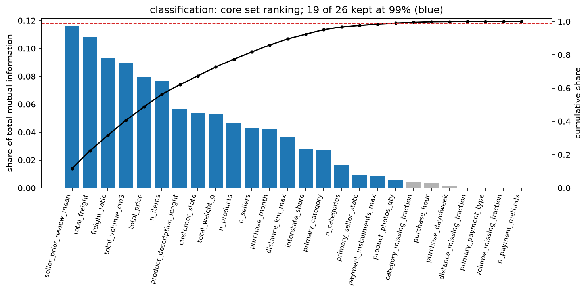

# Review pack: s04_features/classification, round 1

| Field | Value |
| --- | --- |
| Run ID | `20261020T062543Z` |
| Base commit | `2602ebf06b03e55bc86b82ecb60ec8d7c5585386` plus uncommitted changes (committed at acceptance) |
| Outputs | FRESH |
| Coverage | 6 implemented, 1 deviation, 0 missing |
| Failed checks | 0 |
| Ready for acceptance | yes |

## Coverage

| ID | Solution step | Coverage | Checks | Changed since last round | Evidence |
| --- | --- | --- | --- | --- | --- |
| [4.1](#card-4-1) | Baseline | IMPLEMENTED | PASS | yes | [baseline_pool.csv](../../outputs/baseline_pool.csv) |
| [4.2](#card-4-2) | Transforms | IMPLEMENTED | PASS | yes | [transforms.csv](../../outputs/transforms.csv) |
| [4.3](#card-4-3) | Reduction | IMPLEMENTED | PASS | yes | [reduction_rationale.csv](../../outputs/reduction_rationale.csv), [design_matrix.csv](../../outputs/design_matrix.csv) |
| [4.4](#card-4-4) | Selection | IMPLEMENTED | PASS | yes | [selection_ranking.csv](../../outputs/selection_ranking.csv), [selection_cumulative.png](../../outputs/figures/selection_cumulative.png), [selection_cumulative.csv](../../outputs/figures/selection_cumulative.csv), [selection_cumulative.json](../../outputs/figures/selection_cumulative.json), [decision.json](../../outputs/decision.json) |
| [4.6](#card-4-6) | Rationale | DEVIATION | PASS | yes | [feature_dictionary.csv](../../outputs/feature_dictionary.csv) |
| [4.7](#card-4-7) | Selected set | IMPLEMENTED | PASS | yes | [selected_features.json](../../outputs/selected_features.json), [decision.json](../../outputs/decision.json) |
| [4.8](#card-4-8) | Pipeline recipe | IMPLEMENTED | PASS | yes | [recipes.json](../../outputs/recipes.json), [design_matrix.csv](../../outputs/design_matrix.csv) |

## Evidence cards

### 4.1 Baseline {#card-4-1}

Coverage: **IMPLEMENTED**; checks: **PASS**.

- **What was done:** Pool from e5lib.contract.pool('classification'): 27 features = 24 contract predictors + 3 adopted at the s03 gate (product_description_lenght, product_photos_qty, seller_prior_review_mean); 4 categorical, calendar fields numeric (G-22).
- **Conclusion:** has_items, freight_ratio_missing, payment_missing and order_estimated_delivery_date are not in the pool.
- **Claim type:** observation
- **Check order_estimated_delivery_date and est_delivery_days are not features (G-35):** PASS
- **Files:** [baseline_pool.csv](../../outputs/baseline_pool.csv)

### 4.2 Transforms {#card-4-2}

Coverage: **IMPLEMENTED**; checks: **PASS**.

- **What was done:** log1p for 6 of 6 candidates by pre-cutoff skewness > 1: total_price 10.06; total_freight 8.10; total_weight_g 6.59; total_volume_cm3 7.48; distance_km_max 1.64; product_description_lenght 2.05.
- **Reasoning:** Missing values stay missing through log1p and are imputed afterwards inside the fold pipeline (G-47).
- **Claim type:** observation
- **Check every computation reads only pre-cutoff rows:** PASS latest purchase 2018-05-26 12:12:15, cutoff 2018-05-26 12:16:34; 77,736 rows
- **Check log1p only for the log1p candidates with skewness above the trigger:** PASS total_price 10.06, total_freight 8.10, total_weight_g 6.59, total_volume_cm3 7.48, distance_km_max 1.64, product_description_lenght 2.05
- **Check no target cap and no target among the features (G-25):** PASS
- **Files:** [transforms.csv](../../outputs/transforms.csv)

### 4.3 Reduction {#card-4-3}

Coverage: **IMPLEMENTED**; checks: **PASS**.

- **What was done:** Core set 26 of 27: weight_missing_fraction dropped (duplicate, kept volume_missing_fraction). Team collinearity drops: 0 (none flagged in s03). Encoded design matrix: linear: 140 encoded columns, duplicates dropped [missingindicator_total_weight_g; missingindicator_product_photos_qty], 138 columns, rank 138, condition number 1.55e+03; tree: 143 encoded columns, duplicates dropped [missingindicator_total_weight_g; missingindicator_product_photos_qty], 141 columns, rank 139, condition number 7.99e+16.
- **Reasoning:** Rank and condition number are measured once on pre-cutoff rows; the preprocessing fitted for this measurement is not saved. Fields that are always missing together give identical missing indicators, so the 4.3 duplicate rule is applied to the encoded columns inside each training fold (factory step 'dedupe'); the linear/logistic matrix is then full rank. The tree recipe keeps every one-hot level, so its matrix is rank-deficient by design, which does not affect trees.
- **Claim type:** observation
- **Check every computation reads only pre-cutoff rows:** PASS latest purchase 2018-05-26 12:12:15, cutoff 2018-05-26 12:16:34; 77,736 rows
- **Check threshold and collinearity drops read from human_decisions.yaml:** PASS threshold 0.99; team drops 0
- **Check every collinearity drop has a row in reduction_rationale.csv:** PASS
- **Check linear/logistic design matrix has full column rank after the duplicate rule:** PASS rank 138 of 138; tree recipe (full one-hot, no scaling) is rank-deficient by design: each categorical's dummies sum to 1, which does not affect trees
- **Files:** [reduction_rationale.csv](../../outputs/reduction_rationale.csv), [design_matrix.csv](../../outputs/design_matrix.csv)

### 4.4 Selection {#card-4-4}

Coverage: **IMPLEMENTED**; checks: **PASS**.

- **What was done:** Core ranking by mutual information, re-normalised over the 26 core features; 19 kept at the 99% threshold. Dropped by the cut: category_missing_fraction, purchase_hour, purchase_dayofweek, distance_missing_fraction, primary_payment_type, volume_missing_fraction, n_payment_methods.
- **Reasoning:** Declared exception (G-19): the ranking is computed once on pre-cutoff orders, so CV scores of the chosen set are optimistic; the report says so.
- **Claim type:** observation
- **Check every computation reads only pre-cutoff rows:** PASS latest purchase 2018-05-26 12:12:15, cutoff 2018-05-26 12:16:34; 77,736 rows
- **Check ranked feature set equals contract.pool(task) and shares sum to 1:** PASS 27 features, measure: mutual information
- **Check threshold and collinearity drops read from human_decisions.yaml:** PASS threshold 0.99; team drops 0

- **Files:** [selection_ranking.csv](../../outputs/selection_ranking.csv), [selection_cumulative.png](../../outputs/figures/selection_cumulative.png), [selection_cumulative.csv](../../outputs/figures/selection_cumulative.csv), [selection_cumulative.json](../../outputs/figures/selection_cumulative.json), [decision.json](../../outputs/decision.json)

### 4.6 Rationale {#card-4-6}

Coverage: **DEVIATION**; checks: **PASS**.

- **What was done:** feature_dictionary.csv: 33 rows (every pool feature and the derived missing indicators): formula, grain, checkout availability, missingness, transform, imputation, kept and reason, hypothesised signal and candidate references.
- **Reasoning:** References are carried from the Milestone 2 report and are not yet verified against their sources; the hypotheses are tested only by the models (s06-s08).
- **Claim type:** literature-supported hypothesis
- **Deviation:** Citations are Milestone 2 references (Cui et al. 2024, Leite et al. 2024, Deshpande & Pendem) not yet verified against the sources in Experiment 5; the blueprint asks for verified citations.
- **Check feature_dictionary covers every pool feature and every selected feature has a rationale:** PASS
- **Files:** [feature_dictionary.csv](../../outputs/feature_dictionary.csv)

### 4.7 Selected set {#card-4-7}

Coverage: **IMPLEMENTED**; checks: **PASS**.

- **What was done:** selected_features.json: 19 features (16 numeric, 3 categorical), 6 derived missing indicators, log1p inputs ['total_freight', 'total_volume_cm3', 'total_price', 'product_description_lenght', 'total_weight_g', 'distance_km_max']; one set used by every family (G-49).
- **Claim type:** observation
- **Check selected set and threshold recorded in protocol.yaml (data_dependent.selected_set):** PASS
- **Check order_estimated_delivery_date and est_delivery_days are not features (G-35):** PASS
- **Files:** [selected_features.json](../../outputs/selected_features.json), [decision.json](../../outputs/decision.json)

### 4.8 Pipeline recipe {#card-4-8}

Coverage: **IMPLEMENTED**; checks: **PASS**.

- **What was done:** recipes.json: one e5lib.factory spec per family (dummy = dummy_prior, linear = logistic, tree = tree_clf, forest = forest_clf): log1p, median imputation with missing indicators, route median for distance_km_max, one-hot with unknown levels ignored (drop-first and StandardScaler for linear/logistic only).
- **Conclusion:** Fitted only inside each training fold in s06-s08 (G-27).
- **Claim type:** observation
- **Check linear/logistic design matrix has full column rank after the duplicate rule:** PASS rank 138 of 138; tree recipe (full one-hot, no scaling) is rank-deficient by design: each categorical's dummies sum to 1, which does not affect trees
- **Check no fitted object saved in the outputs:** PASS none
- **Check every family recipe builds an estimator from e5lib.factory:** PASS
- **Files:** [recipes.json](../../outputs/recipes.json), [design_matrix.csv](../../outputs/design_matrix.csv)
