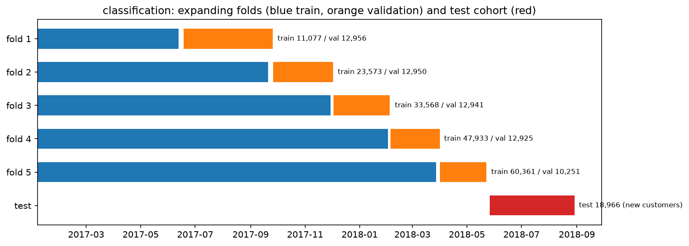

# Review pack: s05_partition/classification, round 1

| Field | Value |
| --- | --- |
| Run ID | `20261020T073908Z` |
| Base commit | `2602ebf06b03e55bc86b82ecb60ec8d7c5585386` plus uncommitted changes (committed at acceptance) |
| Outputs | FRESH |
| Coverage | 7 implemented, 1 deviation, 0 missing |
| Failed checks | 0 |
| Ready for acceptance | yes |

## Coverage

| ID | Solution step | Coverage | Checks | Changed since last round | Evidence |
| --- | --- | --- | --- | --- | --- |
| [5.1](#card-5-1) | Order | IMPLEMENTED | — | yes | — |
| [5.2](#card-5-2) | Test cohort | IMPLEMENTED | PASS | yes | [test_manifest.csv](../../outputs/test_manifest.csv), [counts.json](../../outputs/counts.json) |
| [5.3](#card-5-3) | Test-side purge | IMPLEMENTED | PASS | yes | [test_manifest.csv](../../outputs/test_manifest.csv), [counts.json](../../outputs/counts.json) |
| [5.4](#card-5-4) | Test checks | DEVIATION | PASS | yes | [counts.json](../../outputs/counts.json), [checks.json](../../outputs/checks.json) |
| [5.5](#card-5-5) | CV folds | IMPLEMENTED | PASS | yes | [folds.csv](../../outputs/folds.csv), [fold_summary.csv](../../outputs/fold_summary.csv), [partition_diagram.png](../../outputs/figures/partition_diagram.png), [partition_diagram.csv](../../outputs/figures/partition_diagram.csv), [partition_diagram.json](../../outputs/figures/partition_diagram.json), [checks.json](../../outputs/checks.json) |
| [5.6](#card-5-6) | Fold customer purge | IMPLEMENTED | PASS | yes | [folds.csv](../../outputs/folds.csv), [fold_summary.csv](../../outputs/fold_summary.csv), [checks.json](../../outputs/checks.json) |
| [5.7](#card-5-7) | Label maturity | IMPLEMENTED | PASS | yes | [folds.csv](../../outputs/folds.csv), [fold_summary.csv](../../outputs/fold_summary.csv), [checks.json](../../outputs/checks.json) |
| [5.8](#card-5-8) | Class support and training size | IMPLEMENTED | PASS | yes | [fold_summary.csv](../../outputs/fold_summary.csv), [counts.json](../../outputs/counts.json), [checks.json](../../outputs/checks.json) |

## Evidence cards

### 5.1 Order {#card-5-1}

Coverage: **IMPLEMENTED**; checks: **—**.

- **What was done:** 97,170 eligible classification orders sorted by purchase_ts (ties by order_id): 77,736 development orders before the s02 cutoff 2018-05-26 12:16:34, 19,434 on or after it.
- **Claim type:** observation

### 5.2 Test cohort {#card-5-2}

Coverage: **IMPLEMENTED**; checks: **PASS**.

- **What was done:** Test cohort: every eligible order purchased on or after 2018-05-26 12:16:34; after the purge 18,966 order_ids frozen in test_manifest.csv (2018-05-26 12:16:34 to 2018-08-29 15:00:37).
- **Conclusion:** Defined only by this experiment's data and rules (G-38).
- **Claim type:** observation
- **Check no test order_id or customer_unique_id in development:** PASS 468 repeat-customer test orders removed
- **Check never a random split: test is every eligible order on or after the cutoff, minus repeat customers:** PASS
- **Files:** [test_manifest.csv](../../outputs/test_manifest.csv), [counts.json](../../outputs/counts.json)

### 5.3 Test-side purge {#card-5-3}

Coverage: **IMPLEMENTED**; checks: **PASS**.

- **What was done:** 468 test orders (2.41%) belong to customers who also bought in development and were removed. The new-customer time-ordered holdout holds 18,966 orders, 19.52% of eligible orders after the purge.
- **Claim type:** observation
- **Check no test order_id or customer_unique_id in development:** PASS 468 repeat-customer test orders removed
- **Files:** [test_manifest.csv](../../outputs/test_manifest.csv), [counts.json](../../outputs/counts.json)

### 5.4 Test checks {#card-5-4}

Coverage: **DEVIATION**; checks: **PASS**.

- **What was done:** test keeps >= 15% of eligible reviewed orders: PASS (18,966 of 97,170 = 19.52%); test keeps >= 15% of all eligible detractors: FAIL (1,968 of 13,488 = 14.59%). Prevalence: development 14.78%, test 10.38% (gap -4.41%).
- **Reasoning:** The test cohort is later in time; a gap here is the drift the test score has to face, not a split error. No random fallback exists.
- **Claim type:** observation
- **Deviation:** test keeps >= 15% of all eligible detractors: FAILED (1,968 of 13,488 = 14.59%); accepted by the team as a protocol deviation (G-75): 1,968 test detractors are enough to evaluate the classifier; moving the cutoff after seeing the shares would be a post-hoc change. Reported in s09 with the absolute count (G-54) (experiment lead (Wu Qianzong), 2026-10-20)
- **Check test keeps >= 15% of eligible reviewed orders:** PASS 18,966 of 97,170 = 19.52%
- **Check test keeps >= 15% of all eligible detractors, or a recorded team deviation:** PASS 1,968 of 13,488 = 14.59%: below the minimum, accepted deviation G-75
- **Files:** [counts.json](../../outputs/counts.json), [checks.json](../../outputs/checks.json)

### 5.5 CV folds {#card-5-5}

Coverage: **IMPLEMENTED**; checks: **PASS**.

- **What was done:** 5 expanding folds on development, validation blocks of 12,956 orders each (last block takes the remainder); boundaries written to protocol.yaml data_dependent.fold_boundaries; training strictly before validation in every fold.
- **Claim type:** observation
- **Check every fold: max training purchase time < min validation purchase time:** PASS
- **Check five folds with equal-sized validation blocks before maturity drops:** PASS 12,956, 12,956, 12,956, 12,956, 12,956

- **Files:** [folds.csv](../../outputs/folds.csv), [fold_summary.csv](../../outputs/fold_summary.csv), [partition_diagram.png](../../outputs/figures/partition_diagram.png), [partition_diagram.csv](../../outputs/figures/partition_diagram.csv), [partition_diagram.json](../../outputs/figures/partition_diagram.json), [checks.json](../../outputs/checks.json)

### 5.6 Fold customer purge {#card-5-6}

Coverage: **IMPLEMENTED**; checks: **PASS**.

- **What was done:** Training orders whose customer_unique_id appears in the fold's validation block removed: fold 1 123, fold 2 211, fold 3 265, fold 4 251, fold 5 340 rows.
- **Claim type:** observation
- **Check every fold: no shared customer_unique_id between training and validation:** PASS
- **Files:** [folds.csv](../../outputs/folds.csv), [fold_summary.csv](../../outputs/fold_summary.csv), [checks.json](../../outputs/checks.json)

### 5.7 Label maturity {#card-5-7}

Coverage: **IMPLEMENTED**; checks: **PASS**.

- **What was done:** Training rows need review_label_ts before the validation block starts; validation rows before the test cutoff. Dropped: fold 1 1,756 train / 0 validation, fold 2 2,128 train / 6 validation, fold 3 5,035 train / 15 validation, fold 4 3,640 train / 31 validation, fold 5 4,079 train / 2,705 validation.
- **Claim type:** observation
- **Check every fold: every training label observable before the validation block starts:** PASS 16,638 training rows dropped over the folds
- **Check every validation label observable before the test cutoff:** PASS 2,757 validation rows dropped
- **Files:** [folds.csv](../../outputs/folds.csv), [fold_summary.csv](../../outputs/fold_summary.csv), [checks.json](../../outputs/checks.json)

### 5.8 Class support and training size {#card-5-8}

Coverage: **IMPLEMENTED**; checks: **PASS**.

- **What was done:** Training rows per fold 11,077, 23,573, 33,568, 47,933, 60,361 (minimum 10,000, pre-registered); detractors training/validation 1,410/1,440, 2,798/1,985, 3,993/1,953, 6,312/2,811, 8,694/1,108 (minimum 100).
- **Claim type:** observation
- **Check every fold: training rows >= 10,000 (G-53):** PASS fold 1 11,077; fold 2 23,573; fold 3 33,568; fold 4 47,933; fold 5 60,361
- **Check every fold: both classes present, >= 100 detractors in training and in validation:** PASS fold 1 1,410/1,440; fold 2 2,798/1,985; fold 3 3,993/1,953; fold 4 6,312/2,811; fold 5 8,694/1,108
- **Files:** [fold_summary.csv](../../outputs/fold_summary.csv), [counts.json](../../outputs/counts.json), [checks.json](../../outputs/checks.json)
