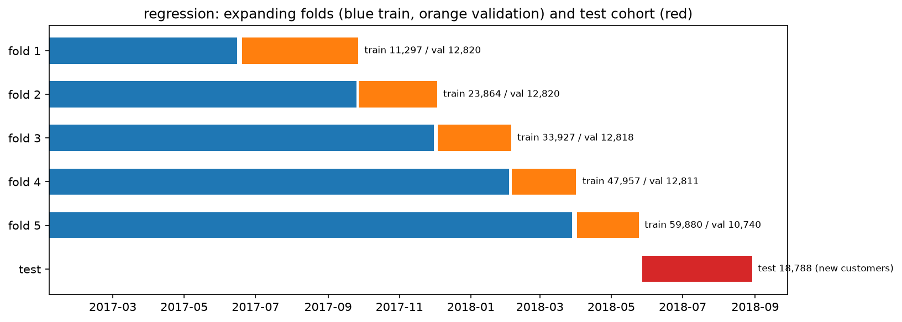

# Review pack: s05_partition/regression, round 1

| Field | Value |
| --- | --- |
| Run ID | `20261020T073917Z` |
| Base commit | `2602ebf06b03e55bc86b82ecb60ec8d7c5585386` plus uncommitted changes (committed at acceptance) |
| Outputs | FRESH |
| Coverage | 8 implemented, 0 deviation, 0 missing |
| Failed checks | 0 |
| Ready for acceptance | yes |

## Coverage

| ID | Solution step | Coverage | Checks | Changed since last round | Evidence |
| --- | --- | --- | --- | --- | --- |
| [5.1](#card-5-1) | Order | IMPLEMENTED | — | yes | — |
| [5.2](#card-5-2) | Test cohort | IMPLEMENTED | PASS | yes | [test_manifest.csv](../../outputs/test_manifest.csv), [counts.json](../../outputs/counts.json) |
| [5.3](#card-5-3) | Test-side purge | IMPLEMENTED | PASS | yes | [test_manifest.csv](../../outputs/test_manifest.csv), [counts.json](../../outputs/counts.json) |
| [5.4](#card-5-4) | Test checks | IMPLEMENTED | PASS | yes | [counts.json](../../outputs/counts.json), [checks.json](../../outputs/checks.json) |
| [5.5](#card-5-5) | CV folds | IMPLEMENTED | PASS | yes | [folds.csv](../../outputs/folds.csv), [fold_summary.csv](../../outputs/fold_summary.csv), [partition_diagram.png](../../outputs/figures/partition_diagram.png), [partition_diagram.csv](../../outputs/figures/partition_diagram.csv), [partition_diagram.json](../../outputs/figures/partition_diagram.json), [checks.json](../../outputs/checks.json) |
| [5.6](#card-5-6) | Fold customer purge | IMPLEMENTED | PASS | yes | [folds.csv](../../outputs/folds.csv), [fold_summary.csv](../../outputs/fold_summary.csv), [checks.json](../../outputs/checks.json) |
| [5.7](#card-5-7) | Label maturity | IMPLEMENTED | PASS | yes | [folds.csv](../../outputs/folds.csv), [fold_summary.csv](../../outputs/fold_summary.csv), [checks.json](../../outputs/checks.json) |
| [5.8](#card-5-8) | Class support and training size | IMPLEMENTED | PASS | yes | [fold_summary.csv](../../outputs/fold_summary.csv), [counts.json](../../outputs/counts.json), [checks.json](../../outputs/checks.json) |

## Evidence cards

### 5.1 Order {#card-5-1}

Coverage: **IMPLEMENTED**; checks: **—**.

- **What was done:** 96,166 eligible regression orders sorted by purchase_ts (ties by order_id): 76,925 development orders before the s02 cutoff 2018-05-27 12:30:34, 19,241 on or after it.
- **Claim type:** observation

### 5.2 Test cohort {#card-5-2}

Coverage: **IMPLEMENTED**; checks: **PASS**.

- **What was done:** Test cohort: every eligible order purchased on or after 2018-05-27 12:30:34; after the purge 18,788 order_ids frozen in test_manifest.csv (2018-05-27 12:30:34 to 2018-08-29 15:00:37).
- **Conclusion:** Defined only by this experiment's data and rules (G-38).
- **Claim type:** observation
- **Check no test order_id or customer_unique_id in development:** PASS 453 repeat-customer test orders removed
- **Check never a random split: test is every eligible order on or after the cutoff, minus repeat customers:** PASS
- **Files:** [test_manifest.csv](../../outputs/test_manifest.csv), [counts.json](../../outputs/counts.json)

### 5.3 Test-side purge {#card-5-3}

Coverage: **IMPLEMENTED**; checks: **PASS**.

- **What was done:** 453 test orders (2.35%) belong to customers who also bought in development and were removed. The new-customer time-ordered holdout holds 18,788 orders, 19.54% of eligible orders after the purge.
- **Claim type:** observation
- **Check no test order_id or customer_unique_id in development:** PASS 453 repeat-customer test orders removed
- **Files:** [test_manifest.csv](../../outputs/test_manifest.csv), [counts.json](../../outputs/counts.json)

### 5.4 Test checks {#card-5-4}

Coverage: **IMPLEMENTED**; checks: **PASS**.

- **What was done:** test keeps >= 15% of eligible delivered orders: PASS (18,788 of 96,166 = 19.54%). lead_days: development mean 13.42 / median 11.17; test mean 8.74 / median 7.43 days.
- **Reasoning:** The test cohort is later in time; a gap here is the drift the test score has to face, not a split error. No random fallback exists.
- **Claim type:** observation
- **Check test keeps >= 15% of eligible delivered orders:** PASS 18,788 of 96,166 = 19.54%
- **Files:** [counts.json](../../outputs/counts.json), [checks.json](../../outputs/checks.json)

### 5.5 CV folds {#card-5-5}

Coverage: **IMPLEMENTED**; checks: **PASS**.

- **What was done:** 5 expanding folds on development, validation blocks of 12,820 orders each (last block takes the remainder); boundaries written to protocol.yaml data_dependent.fold_boundaries; training strictly before validation in every fold.
- **Claim type:** observation
- **Check every fold: max training purchase time < min validation purchase time:** PASS
- **Check five folds with equal-sized validation blocks before maturity drops:** PASS 12,820, 12,820, 12,820, 12,820, 12,820

- **Files:** [folds.csv](../../outputs/folds.csv), [fold_summary.csv](../../outputs/fold_summary.csv), [partition_diagram.png](../../outputs/figures/partition_diagram.png), [partition_diagram.csv](../../outputs/figures/partition_diagram.csv), [partition_diagram.json](../../outputs/figures/partition_diagram.json), [checks.json](../../outputs/checks.json)

### 5.6 Fold customer purge {#card-5-6}

Coverage: **IMPLEMENTED**; checks: **PASS**.

- **What was done:** Training orders whose customer_unique_id appears in the fold's validation block removed: fold 1 123, fold 2 209, fold 3 264, fold 4 254, fold 5 343 rows.
- **Claim type:** observation
- **Check every fold: no shared customer_unique_id between training and validation:** PASS
- **Files:** [folds.csv](../../outputs/folds.csv), [fold_summary.csv](../../outputs/fold_summary.csv), [checks.json](../../outputs/checks.json)

### 5.7 Label maturity {#card-5-7}

Coverage: **IMPLEMENTED**; checks: **PASS**.

- **What was done:** Training rows need lead_label_ts before the validation block starts; validation rows before the test cutoff. Dropped: fold 1 1,405 train / 0 validation, fold 2 1,572 train / 0 validation, fold 3 4,274 train / 2 validation, fold 4 3,074 train / 9 validation, fold 5 3,882 train / 2,080 validation.
- **Claim type:** observation
- **Check every fold: every training label observable before the validation block starts:** PASS 14,207 training rows dropped over the folds
- **Check every validation label observable before the test cutoff:** PASS 2,091 validation rows dropped
- **Files:** [folds.csv](../../outputs/folds.csv), [fold_summary.csv](../../outputs/fold_summary.csv), [checks.json](../../outputs/checks.json)

### 5.8 Class support and training size {#card-5-8}

Coverage: **IMPLEMENTED**; checks: **PASS**.

- **What was done:** Training rows per fold 11,297, 23,864, 33,927, 47,957, 59,880 (minimum 10,000, pre-registered).
- **Claim type:** observation
- **Check every fold: training rows >= 10,000 (G-53):** PASS fold 1 11,297; fold 2 23,864; fold 3 33,927; fold 4 47,957; fold 5 59,880
- **Files:** [fold_summary.csv](../../outputs/fold_summary.csv), [counts.json](../../outputs/counts.json), [checks.json](../../outputs/checks.json)
