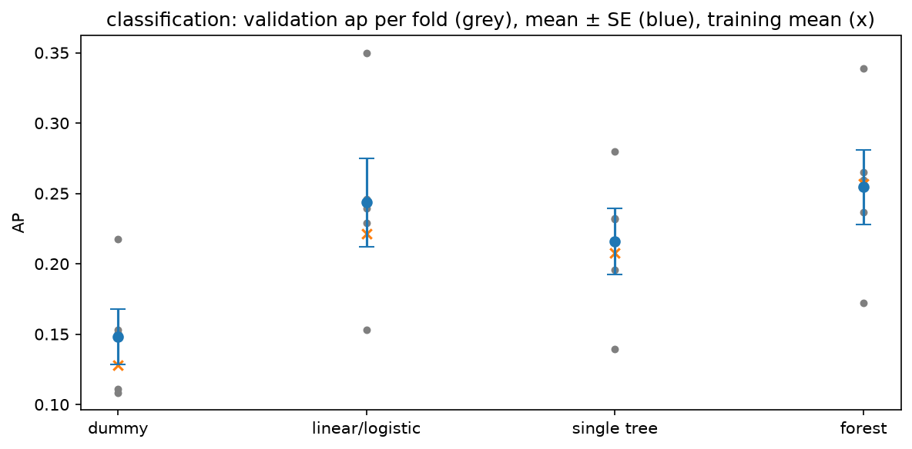
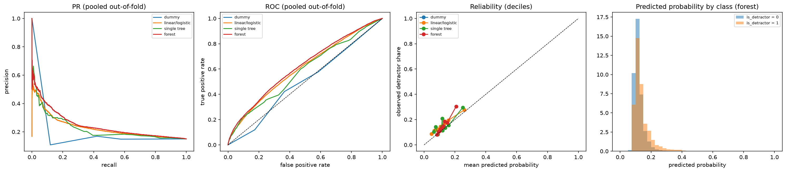
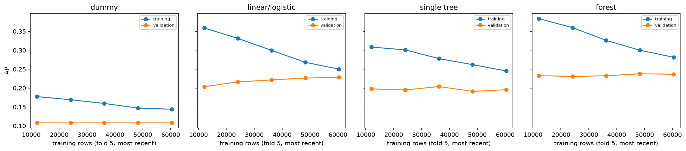

# Review pack: s06_training/classification, round 2

| Field | Value |
| --- | --- |
| Run ID | `20261021T031538Z` |
| Base commit | `a88a4205bb33d4e3a325afee74765a2952b9b5d0` plus uncommitted changes (committed at acceptance) |
| Outputs | FRESH |
| Coverage | 6 implemented, 0 deviation, 0 missing |
| Failed checks | 0 |
| Ready for acceptance | yes |

## Coverage

| ID | Solution step | Coverage | Checks | Changed since last round | Evidence |
| --- | --- | --- | --- | --- | --- |
| [6.1](#card-6-1) | Pipeline factory | IMPLEMENTED | PASS | no | [imputation_by_fold.csv](../../outputs/imputation_by_fold.csv) |
| [6.2](#card-6-2) | Families, basic to complex | IMPLEMENTED | PASS | yes | [candidates.csv](../../outputs/candidates.csv), [paired_differences.csv](../../outputs/paired_differences.csv), [family_ladder.png](../../outputs/figures/family_ladder.png), [family_ladder.csv](../../outputs/figures/family_ladder.csv), [family_ladder.json](../../outputs/figures/family_ladder.json), [counts.json](../../outputs/counts.json), [decision.json](../../outputs/decision.json) |
| [6.4](#card-6-4) | Scores recorded | IMPLEMENTED | PASS | yes | [metrics_long.csv](../../outputs/metrics_long.csv), [predictions.csv.gz](../../outputs/predictions.csv.gz), [fit_log.csv](../../outputs/fit_log.csv), [family_ladder.png](../../outputs/figures/family_ladder.png), [family_ladder.csv](../../outputs/figures/family_ladder.csv), [family_ladder.json](../../outputs/figures/family_ladder.json) |
| [6.6](#card-6-6) | Classification diagnostics | IMPLEMENTED | — | yes | [predictions.csv.gz](../../outputs/predictions.csv.gz), [pr_dummy.csv](../../outputs/curves/pr_dummy.csv), [roc_dummy.csv](../../outputs/curves/roc_dummy.csv), [reliability_dummy.csv](../../outputs/curves/reliability_dummy.csv), [pr_linear.csv](../../outputs/curves/pr_linear.csv), [roc_linear.csv](../../outputs/curves/roc_linear.csv), [reliability_linear.csv](../../outputs/curves/reliability_linear.csv), [pr_tree.csv](../../outputs/curves/pr_tree.csv), [roc_tree.csv](../../outputs/curves/roc_tree.csv), [reliability_tree.csv](../../outputs/curves/reliability_tree.csv), [pr_forest.csv](../../outputs/curves/pr_forest.csv), [roc_forest.csv](../../outputs/curves/roc_forest.csv), [reliability_forest.csv](../../outputs/curves/reliability_forest.csv), [oof_diagnostics.csv](../../outputs/oof_diagnostics.csv), [classification_diagnostics.png](../../outputs/figures/classification_diagnostics.png), [classification_diagnostics.csv](../../outputs/figures/classification_diagnostics.csv), [classification_diagnostics.json](../../outputs/figures/classification_diagnostics.json) |
| [6.7](#card-6-7) | Learning curves and design matrix | IMPLEMENTED | PASS | no | [learning_curves.csv](../../outputs/curves/learning_curves.csv), [learning_curves.png](../../outputs/figures/learning_curves.png), [learning_curves.csv](../../outputs/figures/learning_curves.csv), [learning_curves.json](../../outputs/figures/learning_curves.json), [design_matrix_by_fold.csv](../../outputs/design_matrix_by_fold.csv) |
| [6.8](#card-6-8) | Outputs | IMPLEMENTED | — | no | [counts.json](../../outputs/counts.json) |

## Evidence cards

### 6.1 Pipeline factory {#card-6-1}

Coverage: **IMPLEMENTED**; checks: **PASS**.

- **What was done:** 4 candidates built by e5lib.factory from the s04 recipes.json (one spec per family) with the s06 settings from protocol.yaml; every pipeline fitted inside each of the 5 training folds (176,512 training rows over the folds). Learned imputation values per fold are in imputation_by_fold.csv, with the validation rows whose category level was unseen in the training fold (the one-hot step encodes them as all zeros).
- **Inputs:** s04 recipes.json and selected_features.json; s05 folds.csv; s02 records (development rows).
- **Claim type:** observation
- **Check preprocessing fitted inside the training fold only (learned medians equal the training-fold medians):** PASS 15 fitted pipelines checked
- **Check every candidate uses its s04 recipe unchanged (selected features, log1p inputs):** PASS selected set of 19 features
- **Files:** [imputation_by_fold.csv](../../outputs/imputation_by_fold.csv)

### 6.2 Families, basic to complex {#card-6-2}

Coverage: **IMPLEMENTED**; checks: **PASS**.

- **What was done:** Families basic to complex, validation ap mean ± SE over the folds: dummy 0.1482 ± 0.0198; linear/logistic 0.2435 ± 0.0314; single tree 0.2158 ± 0.0233; forest 0.2544 ± 0.0267. Ladder: linear/logistic kept over dummy; single tree not kept over linear/logistic; forest not kept over linear/logistic. One-SE choice over all four: linear/logistic (best mean: forest).
- **Observation:** Paired per-fold gain of each step (positive = the more complex family is better; description only, s01 1.7): linear/logistic vs dummy +0.0953 (paired SE 0.0157), better in 5 of 5 folds; single tree vs linear/logistic -0.0277 (paired SE 0.0115), better in 0 of 5 folds; forest vs linear/logistic +0.0109 (paired SE 0.0063), better in 4 of 5 folds.
- **Reasoning:** A more complex family is adopted only when its gain over the current family clears one standard error of the fold means (the agreed rule). The fold SE also carries the level differences between folds (drift), so a small but consistent paired gain can stay below it; the paired figures show that without changing the decision.
- **Conclusion:** These are selection scores on the folds, not generalisation estimates (G-10). s07 tunes the linear and tree families and compares each tuned configuration with its plain s06 model (G-55).
- **Claim type:** observation
- **Check identical rows and folds for every candidate:** PASS 4 candidates x 5 folds
- **Check every candidate uses its s04 recipe unchanged (selected features, log1p inputs):** PASS selected set of 19 features
- **Check the simplest model of each family is present (dummy, plain linear/logistic, depth-5 tree, s06 forest):** PASS

- **Files:** [candidates.csv](../../outputs/candidates.csv), [paired_differences.csv](../../outputs/paired_differences.csv), [family_ladder.png](../../outputs/figures/family_ladder.png), [family_ladder.csv](../../outputs/figures/family_ladder.csv), [family_ladder.json](../../outputs/figures/family_ladder.json), [counts.json](../../outputs/counts.json), [decision.json](../../outputs/decision.json)

### 6.4 Scores recorded {#card-6-4}

Coverage: **IMPLEMENTED**; checks: **PASS**.

- **What was done:** metrics_long.csv: training and validation scores for 4 candidates x 5 folds on every s01 metric (threshold metrics at 0.5 and 1/6); fit_log.csv: fit time and warnings (convergence warnings: 0); predictions.csv.gz: 248,092 out-of-fold predictions.
- **Claim type:** observation
- **Check identical rows and folds for every candidate:** PASS 4 candidates x 5 folds
- **Check no test row read: every row used was purchased before the test cutoff:** PASS latest purchase 2018-05-23 11:29:51, cutoff 2018-05-26 12:16:34

- **Files:** [metrics_long.csv](../../outputs/metrics_long.csv), [predictions.csv.gz](../../outputs/predictions.csv.gz), [fit_log.csv](../../outputs/fit_log.csv), [family_ladder.png](../../outputs/figures/family_ladder.png), [family_ladder.csv](../../outputs/figures/family_ladder.csv), [family_ladder.json](../../outputs/figures/family_ladder.json)

### 6.6 Classification diagnostics {#card-6-6}

Coverage: **IMPLEMENTED**; checks: **—**.

- **What was done:** Pooled out-of-fold PR, ROC and reliability curves for every family, Brier score, and the predicted-probability histogram per class for the best non-dummy family. dummy: AP 0.1503, ROC-AUC 0.4990, Brier 0.1281; linear/logistic: AP 0.2297, ROC-AUC 0.6053, Brier 0.1256; single tree: AP 0.2198, ROC-AUC 0.5835, Brier 0.1255; forest: AP 0.2453, ROC-AUC 0.6192, Brier 0.1247.
- **Reasoning:** Pooled curves join the five validation blocks; the selection rule uses the per-fold means in 6.2, so the two can differ slightly.
- **Claim type:** observation

- **Files:** [predictions.csv.gz](../../outputs/predictions.csv.gz), [pr_dummy.csv](../../outputs/curves/pr_dummy.csv), [roc_dummy.csv](../../outputs/curves/roc_dummy.csv), [reliability_dummy.csv](../../outputs/curves/reliability_dummy.csv), [pr_linear.csv](../../outputs/curves/pr_linear.csv), [roc_linear.csv](../../outputs/curves/roc_linear.csv), [reliability_linear.csv](../../outputs/curves/reliability_linear.csv), [pr_tree.csv](../../outputs/curves/pr_tree.csv), [roc_tree.csv](../../outputs/curves/roc_tree.csv), [reliability_tree.csv](../../outputs/curves/reliability_tree.csv), [pr_forest.csv](../../outputs/curves/pr_forest.csv), [roc_forest.csv](../../outputs/curves/roc_forest.csv), [reliability_forest.csv](../../outputs/curves/reliability_forest.csv), [oof_diagnostics.csv](../../outputs/oof_diagnostics.csv), [classification_diagnostics.png](../../outputs/figures/classification_diagnostics.png), [classification_diagnostics.csv](../../outputs/figures/classification_diagnostics.csv), [classification_diagnostics.json](../../outputs/figures/classification_diagnostics.json)

### 6.7 Learning curves and design matrix {#card-6-7}

Coverage: **IMPLEMENTED**; checks: **PASS**.

- **What was done:** Learning curves on fold 5: the most recent 20, 40, 60, 80 and 100% of its training rows against the same validation block (10,251 rows). Linear/logistic design matrix per training fold: fold 1 rank 129 of 129, condition number 763; fold 2 rank 134 of 134, condition number 1.03e+03; fold 3 rank 135 of 135, condition number 1.22e+03; fold 4 rank 137 of 137, condition number 1.47e+03; fold 5 rank 138 of 138, condition number 1.55e+03.
- **Observation:** dummy validation ap 0.1081 with the most recent 20% vs 0.1081 with all rows; linear/logistic validation ap 0.2036 with the most recent 20% vs 0.2288 with all rows; single tree validation ap 0.1978 with the most recent 20% vs 0.1956 with all rows; forest validation ap 0.2327 with the most recent 20% vs 0.2365 with all rows; target mean in fold 5: training 0.1440, validation 0.1081.
- **Reasoning:** Subsets keep the rows closest to the validation block, so a smaller training set is not also an older one; the tree recipe is not measured (rank-deficient by design, s04 M-01).
- **Claim type:** observation
- **Check linear/logistic design matrix full rank in every training fold:** PASS fold 1 rank 129 of 129; fold 2 rank 134 of 134; fold 3 rank 135 of 135; fold 4 rank 137 of 137; fold 5 rank 138 of 138

- **Files:** [learning_curves.csv](../../outputs/curves/learning_curves.csv), [learning_curves.png](../../outputs/figures/learning_curves.png), [learning_curves.csv](../../outputs/figures/learning_curves.csv), [learning_curves.json](../../outputs/figures/learning_curves.json), [design_matrix_by_fold.csv](../../outputs/design_matrix_by_fold.csv)

### 6.8 Outputs {#card-6-8}

Coverage: **IMPLEMENTED**; checks: **—**.

- **What was done:** Outputs: metrics_long.csv, predictions.csv.gz, candidates.csv, decision.json, fit_log.csv, imputation_by_fold.csv, design_matrix_by_fold.csv, curves/ and figures/ with sidecar data.
- **Claim type:** observation
- **Files:** [counts.json](../../outputs/counts.json)
