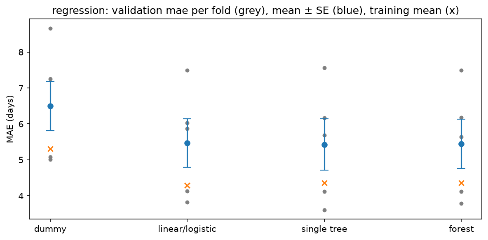
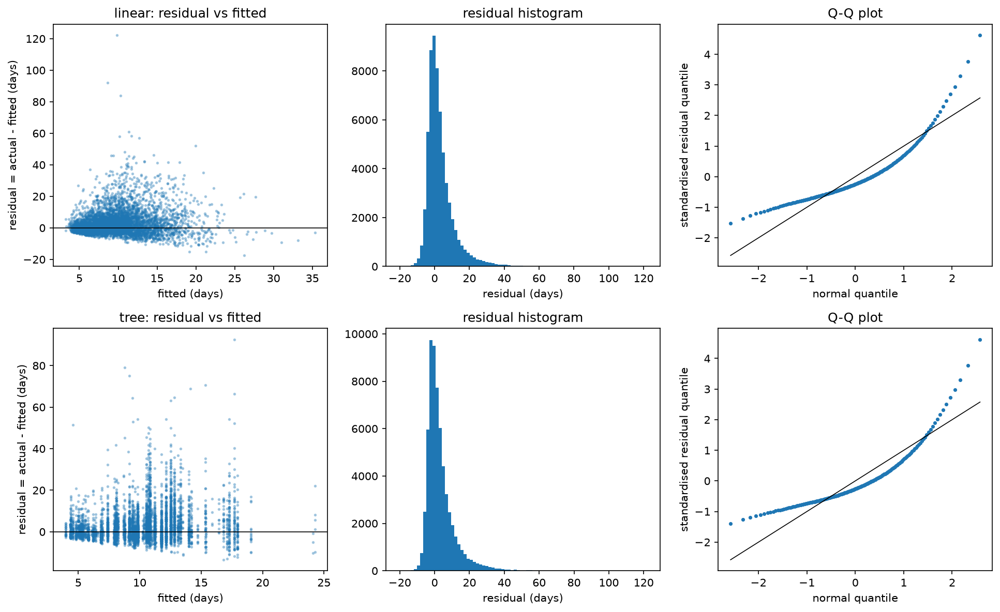
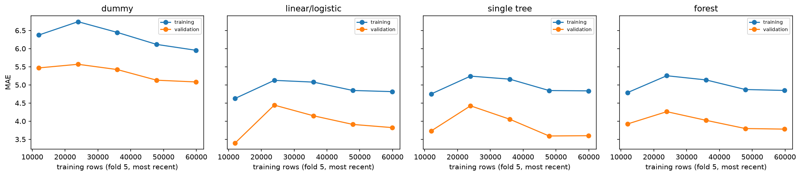

# Review pack: s06_training/regression, round 2

| Field | Value |
| --- | --- |
| Run ID | `20261021T031437Z` |
| Base commit | `a88a4205bb33d4e3a325afee74765a2952b9b5d0` plus uncommitted changes (committed at acceptance) |
| Outputs | FRESH |
| Coverage | 6 implemented, 0 deviation, 0 missing |
| Failed checks | 0 |
| Ready for acceptance | yes |

## Coverage

| ID | Solution step | Coverage | Checks | Changed since last round | Evidence |
| --- | --- | --- | --- | --- | --- |
| [6.1](#card-6-1) | Pipeline factory | IMPLEMENTED | PASS | no | [imputation_by_fold.csv](../../outputs/imputation_by_fold.csv) |
| [6.2](#card-6-2) | Families, basic to complex | IMPLEMENTED | PASS | yes | [candidates.csv](../../outputs/candidates.csv), [paired_differences.csv](../../outputs/paired_differences.csv), [family_ladder.png](../../outputs/figures/family_ladder.png), [family_ladder.csv](../../outputs/figures/family_ladder.csv), [family_ladder.json](../../outputs/figures/family_ladder.json), [counts.json](../../outputs/counts.json), [decision.json](../../outputs/decision.json) |
| [6.4](#card-6-4) | Scores recorded | IMPLEMENTED | PASS | yes | [metrics_long.csv](../../outputs/metrics_long.csv), [predictions.csv.gz](../../outputs/predictions.csv.gz), [fit_log.csv](../../outputs/fit_log.csv), [family_ladder.png](../../outputs/figures/family_ladder.png), [family_ladder.csv](../../outputs/figures/family_ladder.csv), [family_ladder.json](../../outputs/figures/family_ladder.json) |
| [6.5](#card-6-5) | Residual diagnostics | IMPLEMENTED | — | yes | [predictions.csv.gz](../../outputs/predictions.csv.gz), [residual_quantiles_linear.csv](../../outputs/curves/residual_quantiles_linear.csv), [residual_quantiles_tree.csv](../../outputs/curves/residual_quantiles_tree.csv), [residual_diagnostics.png](../../outputs/figures/residual_diagnostics.png), [residual_diagnostics.csv](../../outputs/figures/residual_diagnostics.csv), [residual_diagnostics.json](../../outputs/figures/residual_diagnostics.json) |
| [6.7](#card-6-7) | Learning curves and design matrix | IMPLEMENTED | PASS | yes | [learning_curves.csv](../../outputs/curves/learning_curves.csv), [learning_curves.png](../../outputs/figures/learning_curves.png), [learning_curves.csv](../../outputs/figures/learning_curves.csv), [learning_curves.json](../../outputs/figures/learning_curves.json), [design_matrix_by_fold.csv](../../outputs/design_matrix_by_fold.csv) |
| [6.8](#card-6-8) | Outputs | IMPLEMENTED | — | no | [counts.json](../../outputs/counts.json) |

## Evidence cards

### 6.1 Pipeline factory {#card-6-1}

Coverage: **IMPLEMENTED**; checks: **PASS**.

- **What was done:** 4 candidates built by e5lib.factory from the s04 recipes.json (one spec per family) with the s06 settings from protocol.yaml; every pipeline fitted inside each of the 5 training folds (176,925 training rows over the folds). Learned imputation values per fold are in imputation_by_fold.csv, with the validation rows whose category level was unseen in the training fold (the one-hot step encodes them as all zeros).
- **Inputs:** s04 recipes.json and selected_features.json; s05 folds.csv; s02 records (development rows).
- **Claim type:** observation
- **Check preprocessing fitted inside the training fold only (learned medians equal the training-fold medians):** PASS 15 fitted pipelines checked
- **Check every candidate uses its s04 recipe unchanged (selected features, log1p inputs, log target):** PASS selected set of 18 features
- **Check regression scored on raw days (log target inverted):** PASS
- **Files:** [imputation_by_fold.csv](../../outputs/imputation_by_fold.csv)

### 6.2 Families, basic to complex {#card-6-2}

Coverage: **IMPLEMENTED**; checks: **PASS**.

- **What was done:** Families basic to complex, validation mae mean ± SE over the folds: dummy 6.4946 ± 0.6889 days; linear/logistic 5.4701 ± 0.6733 days; single tree 5.4244 ± 0.7147 days; forest 5.4434 ± 0.6826 days. Ladder: linear/logistic kept over dummy; single tree not kept over linear/logistic; forest not kept over linear/logistic. One-SE choice over all four: linear/logistic (best mean: single tree).
- **Observation:** Paired per-fold gain of each step (positive = the more complex family is better; description only, s01 1.7): linear/logistic vs dummy +1.0245 days (paired SE 0.1262), better in 5 of 5 folds; single tree vs linear/logistic +0.0458 days (paired SE 0.0685), better in 3 of 5 folds; forest vs linear/logistic +0.0267 days (paired SE 0.0601), better in 3 of 5 folds.
- **Reasoning:** A more complex family is adopted only when its gain over the current family clears one standard error of the fold means (the agreed rule). The fold SE also carries the level differences between folds (drift), so a small but consistent paired gain can stay below it; the paired figures show that without changing the decision.
- **Conclusion:** These are selection scores on the folds, not generalisation estimates (G-10). s07 tunes the linear and tree families and compares each tuned configuration with its plain s06 model (G-55).
- **Claim type:** observation
- **Check identical rows and folds for every candidate:** PASS 4 candidates x 5 folds
- **Check every candidate uses its s04 recipe unchanged (selected features, log1p inputs, log target):** PASS selected set of 18 features
- **Check the simplest model of each family is present (dummy, plain linear/logistic, depth-5 tree, s06 forest):** PASS

- **Files:** [candidates.csv](../../outputs/candidates.csv), [paired_differences.csv](../../outputs/paired_differences.csv), [family_ladder.png](../../outputs/figures/family_ladder.png), [family_ladder.csv](../../outputs/figures/family_ladder.csv), [family_ladder.json](../../outputs/figures/family_ladder.json), [counts.json](../../outputs/counts.json), [decision.json](../../outputs/decision.json)

### 6.4 Scores recorded {#card-6-4}

Coverage: **IMPLEMENTED**; checks: **PASS**.

- **What was done:** metrics_long.csv: training and validation scores for 4 candidates x 5 folds on every s01 metric; fit_log.csv: fit time and warnings (convergence warnings: 0); predictions.csv.gz: 248,036 out-of-fold predictions.
- **Claim type:** observation
- **Check identical rows and folds for every candidate:** PASS 4 candidates x 5 folds
- **Check no test row read: every row used was purchased before the test cutoff:** PASS latest purchase 2018-05-24 18:56:59, cutoff 2018-05-27 12:30:34
- **Check regression scored on raw days (log target inverted):** PASS

- **Files:** [metrics_long.csv](../../outputs/metrics_long.csv), [predictions.csv.gz](../../outputs/predictions.csv.gz), [fit_log.csv](../../outputs/fit_log.csv), [family_ladder.png](../../outputs/figures/family_ladder.png), [family_ladder.csv](../../outputs/figures/family_ladder.csv), [family_ladder.json](../../outputs/figures/family_ladder.json)

### 6.5 Residual diagnostics {#card-6-5}

Coverage: **IMPLEMENTED**; checks: **—**.

- **What was done:** Residual vs fitted, histogram and Q-Q plot on out-of-fold predictions of the plain linear model and the better tree model (single tree). linear: residual mean 3.32, median 1.28, skewness 2.65, share above +10 days 14.11%; tree: residual mean 3.22, median 1.05, skewness 2.70, share above +10 days 14.16%.
- **Claim type:** observation

- **Files:** [predictions.csv.gz](../../outputs/predictions.csv.gz), [residual_quantiles_linear.csv](../../outputs/curves/residual_quantiles_linear.csv), [residual_quantiles_tree.csv](../../outputs/curves/residual_quantiles_tree.csv), [residual_diagnostics.png](../../outputs/figures/residual_diagnostics.png), [residual_diagnostics.csv](../../outputs/figures/residual_diagnostics.csv), [residual_diagnostics.json](../../outputs/figures/residual_diagnostics.json)

### 6.7 Learning curves and design matrix {#card-6-7}

Coverage: **IMPLEMENTED**; checks: **PASS**.

- **What was done:** Learning curves on fold 5: the most recent 20, 40, 60, 80 and 100% of its training rows against the same validation block (10,740 rows). Linear/logistic design matrix per training fold: fold 1 rank 128 of 128, condition number 312; fold 2 rank 133 of 133, condition number 341; fold 3 rank 134 of 134, condition number 353; fold 4 rank 137 of 137, condition number 428; fold 5 rank 137 of 137, condition number 454.
- **Observation:** dummy validation mae 5.4686 with the most recent 20% vs 5.0815 with all rows; linear/logistic validation mae 3.3949 with the most recent 20% vs 3.8233 with all rows; single tree validation mae 3.7316 with the most recent 20% vs 3.6002 with all rows; forest validation mae 3.9228 with the most recent 20% vs 3.7815 with all rows; target mean in fold 5: training 13.1094, validation 9.6289.
- **Reasoning:** Subsets keep the rows closest to the validation block, so a smaller training set is not also an older one; the tree recipe is not measured (rank-deficient by design, s04 M-01).
- **Claim type:** observation
- **Check linear/logistic design matrix full rank in every training fold:** PASS fold 1 rank 128 of 128; fold 2 rank 133 of 133; fold 3 rank 134 of 134; fold 4 rank 137 of 137; fold 5 rank 137 of 137

- **Files:** [learning_curves.csv](../../outputs/curves/learning_curves.csv), [learning_curves.png](../../outputs/figures/learning_curves.png), [learning_curves.csv](../../outputs/figures/learning_curves.csv), [learning_curves.json](../../outputs/figures/learning_curves.json), [design_matrix_by_fold.csv](../../outputs/design_matrix_by_fold.csv)

### 6.8 Outputs {#card-6-8}

Coverage: **IMPLEMENTED**; checks: **—**.

- **What was done:** Outputs: metrics_long.csv, predictions.csv.gz, candidates.csv, decision.json, fit_log.csv, imputation_by_fold.csv, design_matrix_by_fold.csv, curves/ and figures/ with sidecar data.
- **Claim type:** observation
- **Files:** [counts.json](../../outputs/counts.json)
