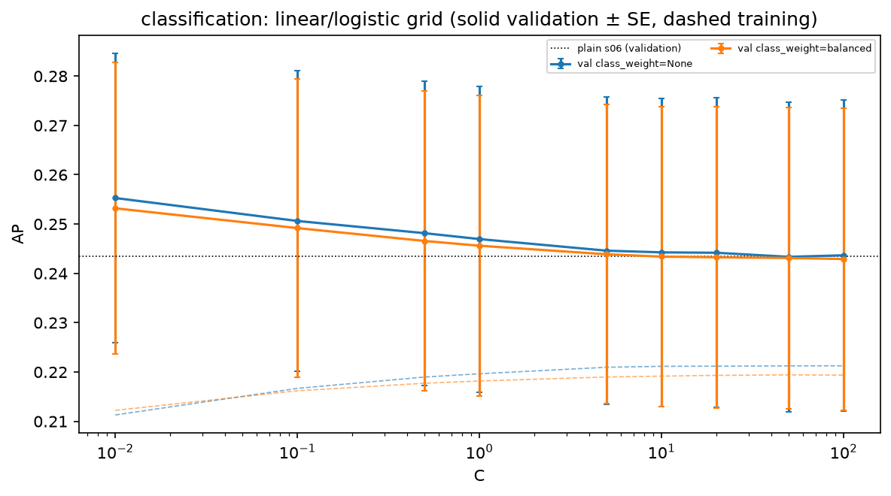
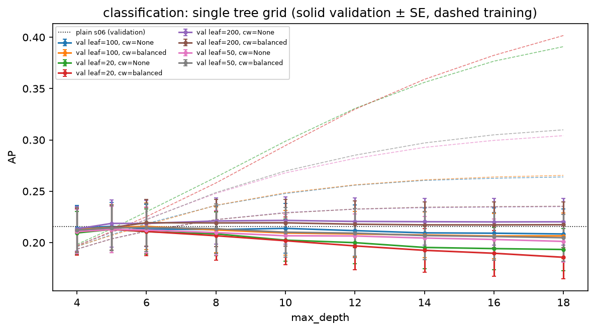
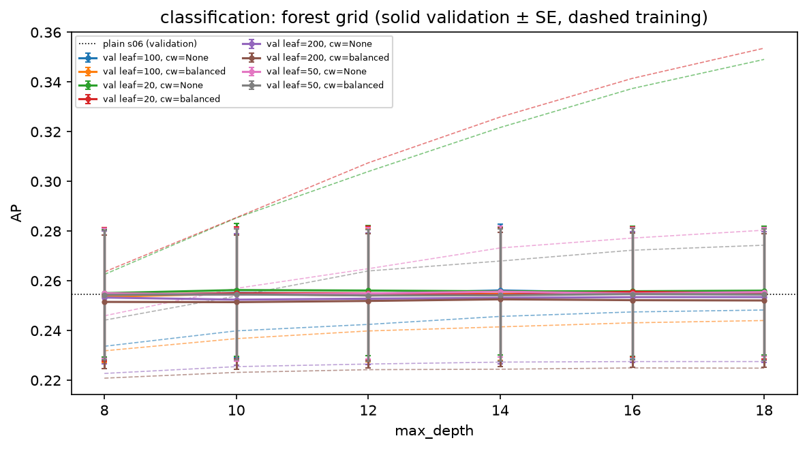

# Review pack: s07_tuning/classification, round 1

| Field | Value |
| --- | --- |
| Run ID | `20261021T040619Z` |
| Base commit | `9853ce53079c1d92566bcfda96eb9a1540585545` plus uncommitted changes (committed at acceptance) |
| Outputs | FRESH |
| Coverage | 6 implemented, 0 deviation, 0 missing |
| Failed checks | 0 |
| Ready for acceptance | yes |

## Coverage

| ID | Solution step | Coverage | Checks | Changed since last round | Evidence |
| --- | --- | --- | --- | --- | --- |
| [7.2](#card-7-2) | Logistic (classification) | IMPLEMENTED | PASS | yes | [grid_results.csv](../../outputs/grid_results.csv) |
| [7.3](#card-7-3) | Decision tree | IMPLEMENTED | PASS | yes | [grid_results.csv](../../outputs/grid_results.csv) |
| [7.4](#card-7-4) | Random forest | IMPLEMENTED | PASS | yes | [grid_results.csv](../../outputs/grid_results.csv) |
| [7.5](#card-7-5) | Search method | IMPLEMENTED | PASS | yes | [grid_results.csv](../../outputs/grid_results.csv), [plain_vs_tuned.csv](../../outputs/plain_vs_tuned.csv), [ladder_preview.csv](../../outputs/ladder_preview.csv), [candidates.csv](../../outputs/candidates.csv), [counts.json](../../outputs/counts.json), [decision.json](../../outputs/decision.json) |
| [7.6](#card-7-6) | Overfitting check | IMPLEMENTED | — | yes | [grid_results.csv](../../outputs/grid_results.csv), [validation_curve_linear.csv](../../outputs/curves/validation_curve_linear.csv), [validation_curve_linear.png](../../outputs/figures/validation_curve_linear.png), [validation_curve_linear.csv](../../outputs/figures/validation_curve_linear.csv), [validation_curve_linear.json](../../outputs/figures/validation_curve_linear.json), [validation_curve_tree.csv](../../outputs/curves/validation_curve_tree.csv), [validation_curve_tree.png](../../outputs/figures/validation_curve_tree.png), [validation_curve_tree.csv](../../outputs/figures/validation_curve_tree.csv), [validation_curve_tree.json](../../outputs/figures/validation_curve_tree.json), [validation_curve_forest.csv](../../outputs/curves/validation_curve_forest.csv), [validation_curve_forest.png](../../outputs/figures/validation_curve_forest.png), [validation_curve_forest.csv](../../outputs/figures/validation_curve_forest.csv), [validation_curve_forest.json](../../outputs/figures/validation_curve_forest.json) |
| [7.7](#card-7-7) | Outputs | IMPLEMENTED | PASS | yes | [predictions.csv.gz](../../outputs/predictions.csv.gz), [oof_scores.csv](../../outputs/oof_scores.csv), [counts.json](../../outputs/counts.json) |

## Evidence cards

### 7.2 Logistic (classification) {#card-7-2}

Coverage: **IMPLEMENTED**; checks: **PASS**.

- **What was done:** linear/logistic: 18 configurations; best mean 0.2553 ({'C': 0.01, 'class_weight': None}); one-SE choice {"C": 0.01, "class_weight": null} with 0.2553 ± 0.0294.
- **Observation:** Against the plain s06 model (0.2435): paired gain of the tuned model +0.0118 (paired SE 0.0045), better in 5 of 5 folds; carried: plain model. For description only, the best-mean grid point against the plain model: paired gain +0.0118 (paired SE 0.0045), better in 5 of 5 folds.
- **Reasoning:** The tuned configuration replaces the plain s06 model only if it beats it by more than one standard error of the fold means (G-55); otherwise the simpler plain model stays.
- **Claim type:** observation
- **Check every configuration comes from the pre-registered protocol.yaml grids (s01, before any s07 output):** PASS linear/logistic 18 configurations; single tree 72 configurations; forest 48 configurations
- **Files:** [grid_results.csv](../../outputs/grid_results.csv)

### 7.3 Decision tree {#card-7-3}

Coverage: **IMPLEMENTED**; checks: **PASS**.

- **What was done:** single tree: 72 configurations; best mean 0.2216 ({'class_weight': None, 'max_depth': 10, 'min_samples_leaf': 200}); one-SE choice {"class_weight": null, "max_depth": 4, "min_samples_leaf": 200} with 0.2134 ± 0.0217.
- **Observation:** Against the plain s06 model (0.2158): paired gain of the tuned model -0.0024 (paired SE 0.0022), better in 2 of 5 folds; carried: plain model. For description only, the best-mean grid point against the plain model: paired gain +0.0058 (paired SE 0.0037), better in 5 of 5 folds.
- **Reasoning:** The tuned configuration replaces the plain s06 model only if it beats it by more than one standard error of the fold means (G-55); otherwise the simpler plain model stays.
- **Claim type:** observation
- **Check every configuration comes from the pre-registered protocol.yaml grids (s01, before any s07 output):** PASS linear/logistic 18 configurations; single tree 72 configurations; forest 48 configurations
- **Check the grid point with the s06 plain settings reproduces the s06 fold scores (tree, forest):** PASS 2 of 2 reproduced
- **Files:** [grid_results.csv](../../outputs/grid_results.csv)

### 7.4 Random forest {#card-7-4}

Coverage: **IMPLEMENTED**; checks: **PASS**.

- **What was done:** forest: 48 configurations; best mean 0.2563 ({'class_weight': None, 'max_depth': 10, 'max_features': 'sqrt', 'min_samples_leaf': 20}); one-SE choice {"class_weight": null, "max_depth": 8, "max_features": "sqrt", "min_samples_leaf": 200} with 0.2533 ± 0.0268.
- **Observation:** Against the plain s06 model (0.2544): paired gain of the tuned model -0.0012 (paired SE 0.0005), better in 1 of 5 folds; carried: plain model. For description only, the best-mean grid point against the plain model: paired gain +0.0019 (paired SE 0.0008), better in 4 of 5 folds.
- **Reasoning:** The tuned configuration replaces the plain s06 model only if it beats it by more than one standard error of the fold means (G-55); otherwise the simpler plain model stays.
- **Claim type:** observation
- **Check every configuration comes from the pre-registered protocol.yaml grids (s01, before any s07 output):** PASS linear/logistic 18 configurations; single tree 72 configurations; forest 48 configurations
- **Check the grid point with the s06 plain settings reproduces the s06 fold scores (tree, forest):** PASS 2 of 2 reproduced
- **Files:** [grid_results.csv](../../outputs/grid_results.csv)

### 7.5 Search method {#card-7-5}

Coverage: **IMPLEMENTED**; checks: **PASS**.

- **What was done:** GridSearchCV over the whole s04 pipeline on the s05 folds, scoring average_precision, refit=False, return_train_score=True, seed 42; 138 configurations in total. Carried per family: linear/logistic plain s06; single tree plain s06; forest plain s06. Ladder over the carried families (description only; s08 decides): linear/logistic kept over dummy (paired gain +0.0953, better in 5 of 5 folds); single tree not kept over linear/logistic (paired gain -0.0277, better in 0 of 5 folds); forest not kept over linear/logistic (paired gain +0.0109, better in 4 of 5 folds); result linear/logistic.
- **Conclusion:** Selection scores on the folds, not generalisation estimates (G-10). The finalists and the final choice are made in s08 at its gate (G-39).
- **Claim type:** observation
- **Check same folds as s06 (rows per fold equal):** PASS
- **Check every configuration scored on all five folds, whole pipeline refitted per fold:** PASS
- **Check no test row read: every row used was purchased before the test cutoff:** PASS latest purchase 2018-05-26 12:12:15, cutoff 2018-05-26 12:16:34
- **Files:** [grid_results.csv](../../outputs/grid_results.csv), [plain_vs_tuned.csv](../../outputs/plain_vs_tuned.csv), [ladder_preview.csv](../../outputs/ladder_preview.csv), [candidates.csv](../../outputs/candidates.csv), [counts.json](../../outputs/counts.json), [decision.json](../../outputs/decision.json)

### 7.6 Overfitting check {#card-7-6}

Coverage: **IMPLEMENTED**; checks: **—**.

- **What was done:** train_validation_gap for every configuration in grid_results.csv (positive = worse on validation). Gap of each family's one-SE choice: linear/logistic -0.0440; single tree -0.0200; forest -0.0305.
- **Reasoning:** The one-SE choice is already the simplest configuration within the rule, so no simpler configuration within the rule exists to flag; the gaps are reported for the review.
- **Claim type:** observation

- **Files:** [grid_results.csv](../../outputs/grid_results.csv), [validation_curve_linear.csv](../../outputs/curves/validation_curve_linear.csv), [validation_curve_linear.png](../../outputs/figures/validation_curve_linear.png), [validation_curve_linear.csv](../../outputs/figures/validation_curve_linear.csv), [validation_curve_linear.json](../../outputs/figures/validation_curve_linear.json), [validation_curve_tree.csv](../../outputs/curves/validation_curve_tree.csv), [validation_curve_tree.png](../../outputs/figures/validation_curve_tree.png), [validation_curve_tree.csv](../../outputs/figures/validation_curve_tree.csv), [validation_curve_tree.json](../../outputs/figures/validation_curve_tree.json), [validation_curve_forest.csv](../../outputs/curves/validation_curve_forest.csv), [validation_curve_forest.png](../../outputs/figures/validation_curve_forest.png), [validation_curve_forest.csv](../../outputs/figures/validation_curve_forest.csv), [validation_curve_forest.json](../../outputs/figures/validation_curve_forest.json)

### 7.7 Outputs {#card-7-7}

Coverage: **IMPLEMENTED**; checks: **PASS**.

- **What was done:** grid_results.csv, plain_vs_tuned.csv, ladder_preview.csv, candidates.csv, decision.json, out-of-fold predictions of each family's best (predictions.csv.gz) with pooled vs mean-fold scores (oof_scores.csv), validation curves (curves/, figures/); fit times in _manifest.json.
- **Claim type:** observation
- **Check refitting each family's best per fold gives the grid's validation scores:** PASS 15 refits
- **Files:** [predictions.csv.gz](../../outputs/predictions.csv.gz), [oof_scores.csv](../../outputs/oof_scores.csv), [counts.json](../../outputs/counts.json)
