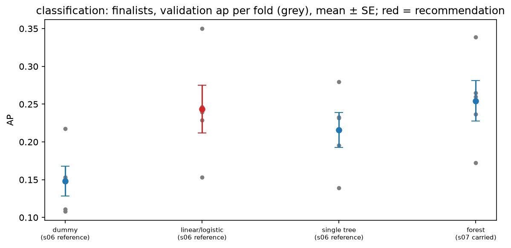
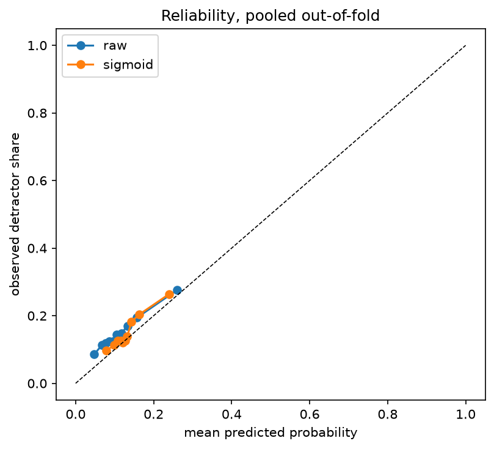
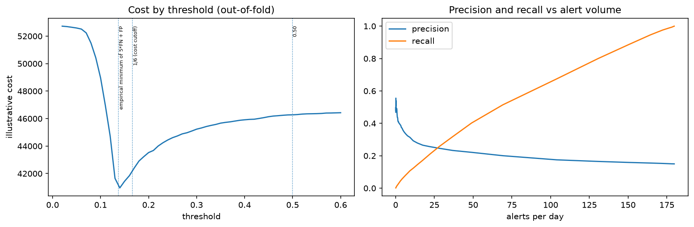

# Review pack: s08_selection/classification, round 1

| Field | Value |
| --- | --- |
| Run ID | `20261021T050340Z` |
| Base commit | `6198c2c0e30a49848d0d86a8052e98eedc5ba025` plus uncommitted changes (committed at acceptance) |
| Outputs | FRESH |
| Coverage | 4 implemented, 0 deviation, 4 missing |
| Failed checks | 0 |
| Ready for acceptance | no |

## Coverage

| ID | Solution step | Coverage | Checks | Changed since last round | Evidence |
| --- | --- | --- | --- | --- | --- |
| [8.1](#card-8-1) | Finalists | IMPLEMENTED | PASS | yes | [metrics_long.csv](../../outputs/metrics_long.csv), [predictions.csv.gz](../../outputs/predictions.csv.gz), [candidates.csv](../../outputs/candidates.csv), [finalists.png](../../outputs/figures/finalists.png), [finalists.csv](../../outputs/figures/finalists.csv), [finalists.json](../../outputs/figures/finalists.json), [counts.json](../../outputs/counts.json) |
| [8.2](#card-8-2) | Choose the model | IMPLEMENTED | PASS | yes | [candidates.csv](../../outputs/candidates.csv), [ladder.csv](../../outputs/ladder.csv), [finalists.png](../../outputs/figures/finalists.png), [finalists.csv](../../outputs/figures/finalists.csv), [finalists.json](../../outputs/figures/finalists.json), [selected_spec.json](../../outputs/selected_spec.json), [counts.json](../../outputs/counts.json), [selection_review_pack.md](../../outputs/selection_review_pack.md), [decision.json](../../outputs/decision.json) |
| [8.3](#card-8-3) | Calibration | IMPLEMENTED | PASS | yes | [predictions.csv.gz](../../outputs/predictions.csv.gz), [calibration_folds.csv](../../outputs/calibration_folds.csv), [reliability_raw_vs_sigmoid.csv](../../outputs/curves/reliability_raw_vs_sigmoid.csv), [calibration.png](../../outputs/figures/calibration.png), [calibration.csv](../../outputs/figures/calibration.csv), [calibration.json](../../outputs/figures/calibration.json), [selected_spec.json](../../outputs/selected_spec.json), [selection_review_pack.md](../../outputs/selection_review_pack.md), [decision.json](../../outputs/decision.json) |
| [8.4](#card-8-4) | Threshold | IMPLEMENTED | — | yes | [threshold_table.csv](../../outputs/threshold_table.csv), [threshold_curve.csv](../../outputs/curves/threshold_curve.csv), [threshold_tradeoff.png](../../outputs/figures/threshold_tradeoff.png), [threshold_tradeoff.csv](../../outputs/figures/threshold_tradeoff.csv), [threshold_tradeoff.json](../../outputs/figures/threshold_tradeoff.json), [selection_review_pack.md](../../outputs/selection_review_pack.md), [decision.json](../../outputs/decision.json) |
| [8.5](#card-8-5) | Freeze | MISSING | — | yes | — |
| [8.6](#card-8-6) | Final fit | MISSING | — | yes | — |
| [8.7](#card-8-7) | Test once | MISSING | — | yes | — |
| [8.8](#card-8-8) | Bundle | MISSING | — | yes | — |

## Evidence cards

### 8.1 Finalists {#card-8-1}

Coverage: **IMPLEMENTED**; checks: **PASS**.

- **What was done:** 4 finalists refitted on the five s05 folds: dummy (s06 reference) 0.1482 ± 0.0198; linear/logistic (s06 reference) 0.2435 ± 0.0314; single tree (s06 reference) 0.2158 ± 0.0233; forest (s07 carried (plain s06)) 0.2544 ± 0.0267 (validation ap, mean ± SE).
- **Inputs:** s06 metrics and learning curves; s07 counts.json (carried model per family) and grid_results.csv; s05 folds.
- **Claim type:** observation
- **Check finalists refitted on the same rows and folds reproduce their s06 fold scores:** PASS 4 of 4 reproduced
- **Check finalists: the dummy, plain linear/logistic and single tree references plus each family's s07 carried model:** PASS 4 finalists
- **Check no test row read: every row used was purchased before the test cutoff:** PASS latest purchase 2018-05-23 11:29:51, cutoff 2018-05-26 12:16:34

- **Files:** [metrics_long.csv](../../outputs/metrics_long.csv), [predictions.csv.gz](../../outputs/predictions.csv.gz), [candidates.csv](../../outputs/candidates.csv), [finalists.png](../../outputs/figures/finalists.png), [finalists.csv](../../outputs/figures/finalists.csv), [finalists.json](../../outputs/figures/finalists.json), [counts.json](../../outputs/counts.json)

### 8.2 Choose the model {#card-8-2}

Coverage: **IMPLEMENTED**; checks: **PASS**.

- **What was done:** One-SE recommendation: linear/logistic (best mean: forest). Ladder basic to complex: linear/logistic kept over dummy (paired gain +0.0953, better in 5 of 5 folds); single tree not kept over linear/logistic (paired gain -0.0277, better in 0 of 5 folds); forest not kept over linear/logistic (paired gain +0.0109, better in 4 of 5 folds); ladder result linear/logistic. Grid edge of the recommendation: plain s06 model, not a grid configuration.
- **Reasoning:** The recommendation follows the pre-registered rule; the team confirms or overrides it at the gate (G-39), and an override is logged as a protocol deviation (G-44). Validation scores are selection scores, not generalisation estimates (G-10).
- **Conclusion:** The run stops here. Under G-78 the team reviews s06, s07 and s08 together before the freeze, the final fit and the single test (8.5-8.8).
- **Claim type:** observation
- **Check no test row read: every row used was purchased before the test cutoff:** PASS latest purchase 2018-05-23 11:29:51, cutoff 2018-05-26 12:16:34
- **Check the run stops at the gate: no frozen_recipe.json, the test cohort is not read (G-39, G-78):** PASS team decisions in human_decisions.yaml s08: not yet made

- **Files:** [candidates.csv](../../outputs/candidates.csv), [ladder.csv](../../outputs/ladder.csv), [finalists.png](../../outputs/figures/finalists.png), [finalists.csv](../../outputs/figures/finalists.csv), [finalists.json](../../outputs/figures/finalists.json), [selected_spec.json](../../outputs/selected_spec.json), [counts.json](../../outputs/counts.json), [selection_review_pack.md](../../outputs/selection_review_pack.md), [decision.json](../../outputs/decision.json)

### 8.3 Calibration {#card-8-3}

Coverage: **IMPLEMENTED**; checks: **PASS**.

- **What was done:** Raw vs sigmoid (CalibratedClassifierCV, time-ordered inner splits) on the recommended model, per fold: mean Brier raw 0.12426 vs sigmoid 0.12391; mean AP raw 0.2435 vs sigmoid 0.2317 (one fold SE 0.0314). Kept: sigmoid.
- **Claim type:** observation
- **Check calibration inner splits are time-ordered: every training fold sorted by purchase time:** PASS

- **Files:** [predictions.csv.gz](../../outputs/predictions.csv.gz), [calibration_folds.csv](../../outputs/calibration_folds.csv), [reliability_raw_vs_sigmoid.csv](../../outputs/curves/reliability_raw_vs_sigmoid.csv), [calibration.png](../../outputs/figures/calibration.png), [calibration.csv](../../outputs/figures/calibration.csv), [calibration.json](../../outputs/figures/calibration.json), [selected_spec.json](../../outputs/selected_spec.json), [selection_review_pack.md](../../outputs/selection_review_pack.md), [decision.json](../../outputs/decision.json)

### 8.4 Threshold {#card-8-4}

Coverage: **IMPLEMENTED**; checks: **—**.

- **What was done:** Threshold candidates on the out-of-fold probabilities of the calibrated recommended model (62,023 validation rows, 345 days): 0.50 (t=0.5000): 0.3 alerts/day, precision 0.537, recall 0.005, cost 46,274; 1/6 (cost cutoff) (t=0.1667): 23.9 alerts/day, precision 0.252, recall 0.223, cost 42,255; empirical minimum of 5*FN + FP (t=0.1371): 53.5 alerts/day, precision 0.218, recall 0.432, cost 40,839; no alerts: cost 46,485.
- **Reasoning:** Under the 5:1 cost an alert pays off while the extra false alarms per extra detractor caught stay at or below 5 (Elkan 2001). The threshold is a business choice: the team picks it at the hard stop, with an optional daily alert cap (G-39, G-56).
- **Claim type:** observation

- **Files:** [threshold_table.csv](../../outputs/threshold_table.csv), [threshold_curve.csv](../../outputs/curves/threshold_curve.csv), [threshold_tradeoff.png](../../outputs/figures/threshold_tradeoff.png), [threshold_tradeoff.csv](../../outputs/figures/threshold_tradeoff.csv), [threshold_tradeoff.json](../../outputs/figures/threshold_tradeoff.json), [selection_review_pack.md](../../outputs/selection_review_pack.md), [decision.json](../../outputs/decision.json)

### 8.5 Freeze {#card-8-5}

Coverage: **MISSING**; checks: **—**.

### 8.6 Final fit {#card-8-6}

Coverage: **MISSING**; checks: **—**.

### 8.7 Test once {#card-8-7}

Coverage: **MISSING**; checks: **—**.

### 8.8 Bundle {#card-8-8}

Coverage: **MISSING**; checks: **—**.

