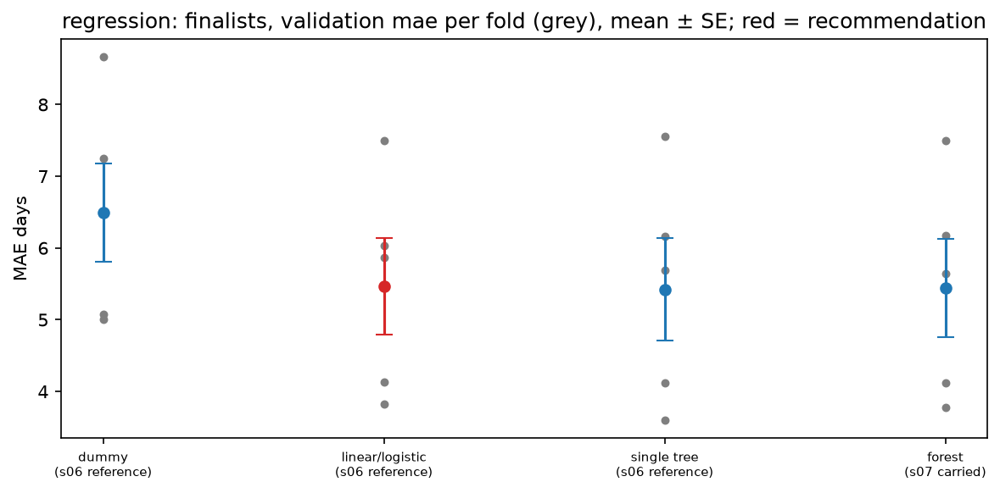

# Review pack: s08_selection/regression, round 2

| Field | Value |
| --- | --- |
| Run ID | `20261023T082458Z` |
| Base commit | `6198c2c0e30a49848d0d86a8052e98eedc5ba025` plus uncommitted changes (committed at acceptance) |
| Outputs | FRESH |
| Coverage | 3 implemented, 0 deviation, 3 missing |
| Failed checks | 0 |
| Ready for acceptance | no |

## Coverage

| ID | Solution step | Coverage | Checks | Changed since last round | Evidence |
| --- | --- | --- | --- | --- | --- |
| [8.1](#card-8-1) | Finalists | IMPLEMENTED | PASS | yes | [metrics_long.csv](../../outputs/metrics_long.csv), [predictions.csv.gz](../../outputs/predictions.csv.gz), [candidates.csv](../../outputs/candidates.csv), [finalists.png](../../outputs/figures/finalists.png), [finalists.csv](../../outputs/figures/finalists.csv), [finalists.json](../../outputs/figures/finalists.json), [counts.json](../../outputs/counts.json) |
| [8.2](#card-8-2) | Choose the model | IMPLEMENTED | PASS | yes | [candidates.csv](../../outputs/candidates.csv), [ladder.csv](../../outputs/ladder.csv), [finalists.png](../../outputs/figures/finalists.png), [finalists.csv](../../outputs/figures/finalists.csv), [finalists.json](../../outputs/figures/finalists.json), [selected_spec.json](../../outputs/selected_spec.json), [counts.json](../../outputs/counts.json), [selection_review_pack.md](../../outputs/selection_review_pack.md), [decision.json](../../outputs/decision.json) |
| [8.5](#card-8-5) | Freeze | IMPLEMENTED | PASS | yes | [frozen_recipe.json](../../outputs/frozen_recipe.json), [counts.json](../../outputs/counts.json), [selection_review_pack.md](../../outputs/selection_review_pack.md), [decision.json](../../outputs/decision.json) |
| [8.6](#card-8-6) | Final fit | MISSING | — | no | — |
| [8.7](#card-8-7) | Test once | MISSING | — | no | — |
| [8.8](#card-8-8) | Bundle | MISSING | — | no | — |

## Evidence cards

### 8.1 Finalists {#card-8-1}

Coverage: **IMPLEMENTED**; checks: **PASS**.

- **What was done:** 4 finalists refitted on the five s05 folds: dummy (s06 reference) 6.4946 ± 0.6889 days; linear/logistic (s06 reference) 5.4701 ± 0.6733 days; single tree (s06 reference) 5.4244 ± 0.7147 days; forest (s07 carried (plain s06)) 5.4434 ± 0.6826 days (validation mae, mean ± SE).
- **Inputs:** s06 metrics and learning curves; s07 counts.json (carried model per family) and grid_results.csv; s05 folds.
- **Claim type:** observation
- **Check finalists refitted on the same rows and folds reproduce their s06 fold scores:** PASS 4 of 4 reproduced
- **Check finalists: the dummy, plain linear/logistic and single tree references plus each family's s07 carried model:** PASS 4 finalists
- **Check no test row read: every row used was purchased before the test cutoff:** PASS latest purchase 2018-05-24 18:56:59, cutoff 2018-05-27 12:30:34

- **Files:** [metrics_long.csv](../../outputs/metrics_long.csv), [predictions.csv.gz](../../outputs/predictions.csv.gz), [candidates.csv](../../outputs/candidates.csv), [finalists.png](../../outputs/figures/finalists.png), [finalists.csv](../../outputs/figures/finalists.csv), [finalists.json](../../outputs/figures/finalists.json), [counts.json](../../outputs/counts.json)

### 8.2 Choose the model {#card-8-2}

Coverage: **IMPLEMENTED**; checks: **PASS**.

- **What was done:** One-SE recommendation: linear/logistic (best mean: single tree). Ladder basic to complex: linear/logistic kept over dummy (paired gain +1.0245 days, better in 5 of 5 folds); single tree not kept over linear/logistic (paired gain +0.0458 days, better in 3 of 5 folds); forest not kept over linear/logistic (paired gain +0.0267 days, better in 3 of 5 folds); ladder result linear/logistic. Grid edge of the recommendation: plain s06 model, not a grid configuration.
- **Reasoning:** The recommendation follows the pre-registered rule; the team confirms or overrides it at the gate (G-39), and an override is logged as a protocol deviation (G-44). Validation scores are selection scores, not generalisation estimates (G-10).
- **Conclusion:** The team confirmed the recommendation at the combined review of s06-s08 (human_decisions.yaml s08, 2026-10-23).
- **Claim type:** observation
- **Check no test row read: every row used was purchased before the test cutoff:** PASS latest purchase 2018-05-24 18:56:59, cutoff 2018-05-27 12:30:34

- **Files:** [candidates.csv](../../outputs/candidates.csv), [ladder.csv](../../outputs/ladder.csv), [finalists.png](../../outputs/figures/finalists.png), [finalists.csv](../../outputs/figures/finalists.csv), [finalists.json](../../outputs/figures/finalists.json), [selected_spec.json](../../outputs/selected_spec.json), [counts.json](../../outputs/counts.json), [selection_review_pack.md](../../outputs/selection_review_pack.md), [decision.json](../../outputs/decision.json)

### 8.5 Freeze {#card-8-5}

Coverage: **IMPLEMENTED**; checks: **PASS**.

- **What was done:** Recipe frozen for reg.sel.log.linear: 14 numeric and 4 categorical features, estimator linear, calibration none; sha256 df4beee32d7b6bef5736e21e53aad6b1caea3233a066c222e46708aca38899d2. Written from development rows only; the test cohort is not loaded.
- **Inputs:** spec/human_decisions.yaml s08 (team decisions, 2026-10-23); this run's finalists, calibration and threshold table.
- **Conclusion:** Pipeline A stops after the freeze. The final fit, the single test read and the bundle (8.6-8.8) run together with Pipeline B (lead decision 2026-10-23; draft G-79).
- **Claim type:** observation
- **Check frozen recipe follows the team decisions: chosen model is a finalist and the recommendation:** PASS reg.sel.log.linear
- **Check frozen before any test row is read: the run uses development rows only, all purchased before the cutoff:** PASS sha256 df4beee32d7b6bef5736e21e53aad6b1caea3233a066c222e46708aca38899d2
- **Files:** [frozen_recipe.json](../../outputs/frozen_recipe.json), [counts.json](../../outputs/counts.json), [selection_review_pack.md](../../outputs/selection_review_pack.md), [decision.json](../../outputs/decision.json)

### 8.6 Final fit {#card-8-6}

Coverage: **MISSING**; checks: **—**.

### 8.7 Test once {#card-8-7}

Coverage: **MISSING**; checks: **—**.

### 8.8 Bundle {#card-8-8}

Coverage: **MISSING**; checks: **—**.

